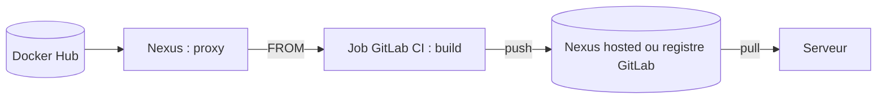

# Cours - Construire et publier les images d'un projet avec GitLab CI

> [!abstract] Objectifs
> - Reprendre un projet open source de GitHub sur le GitLab de l'entreprise
> - Comprendre comment ses images Docker sont construites
> - Récupérer les images de base via le Nexus plutôt que Docker Hub
> - Écrire une pipeline GitLab qui construit et publie ces images

**Prérequis :** [[Docker]] · [[Image Docker]] · [[Git]]

## 1. Le point de départ
Un projet open source (ici CVAT) vit sur GitHub, avec sa propre CI (GitHub Actions, dans `.github/workflows/`). L'objectif est de le faire vivre sur le GitLab de l'entreprise : le code, mais aussi la construction de ses images. Première étape : garder une copie sur GitLab tout en pouvant suivre les nouvelles versions, voir [[Dépôt upstream]].

## 2. Comment le projet construit ses images
Les images sont décrites par un ou plusieurs [[Dockerfile]]. La ligne clé est `FROM` : elle dit d'où vient l'image de départ. Sans registre précisé, c'est Docker Hub. Le fichier `docker-compose.yml` montre quelles images le projet **construit** et lesquelles il **télécharge** seulement.

## 3. Le trajet d'une image

- Les images de base passent par le [[Nexus]], car Internet est souvent filtré en entreprise.
- Le nom complet d'une image indique son [[Registre Docker|registre]] : changer de registre, c'est changer ce préfixe.
- Pour éviter de modifier le Dockerfile en dur, on peut paramétrer l'image de base avec une [[Variable de build Docker (ARG)]].

## 4. La pipeline
Une [[Pipeline GitLab CI]] enchaîne des stages et des jobs décrits dans `.gitlab-ci.yml`. Le job de build :
1. se connecte au registre avec des identifiants rangés dans les [[Variables CI-CD GitLab]] ;
2. construit l'image ([[Construire une image dans la CI]] avec Docker-in-Docker, ou [[Kaniko]] si le runner n'est pas privilégié) ;
3. la pousse avec un tag précis, par exemple `$CI_COMMIT_SHORT_SHA`.

Commandes : [[docker login]] · [[docker build]] · [[docker tag]] · [[docker push]]

## 5. Les questions à poser à l'équipe
- Adresse du dépôt Docker proxy ou group du Nexus, et où pousser les images construites
- Compte de service à utiliser depuis la CI
- Proxys Nexus pour pip, npm et apt (les Dockerfile installent des paquets)
- Docker-in-Docker autorisé, ou Kaniko à utiliser

## Mise en pratique
- Dans le dépôt CVAT, liste les Dockerfile et leurs lignes `FROM`.
- Décide : modifier les `FROM` en dur, ou les rendre paramétrables ? Pourquoi ?
- Dessine (liste ou schéma) les stages et jobs de ta pipeline avant d'écrire le YAML.
- Écris un premier `.gitlab-ci.yml` avec un seul job `docker version`, et fais-le passer au vert.

> [!warning] Erreurs fréquentes
> - Changer le `FROM` mais oublier que l'`image:` des jobs vient aussi de Docker Hub
> - Oublier `library/` dans le chemin d'une image officielle via Nexus
> - Écrire un mot de passe dans le `.gitlab-ci.yml`
> - Pousser vers un dépôt proxy au lieu d'un dépôt hosted

## Résumé
En 3 phrases, avec mes mots.

## Concepts du cours
[[Dépôt upstream]] · [[Dockerfile]] · [[Registre Docker]] · [[Nexus]] · [[Variable de build Docker (ARG)]] · [[Pipeline GitLab CI]] · [[Variables CI-CD GitLab]] · [[Construire une image dans la CI]] · [[Kaniko]]
