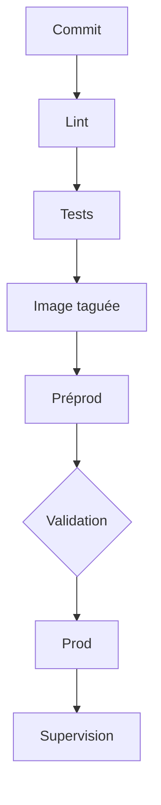

# Cours - Livrer en continu, environnements et supervision

> [!abstract] Objectifs
> - Concevoir une pipeline complète, de la vérification au déploiement
> - Gérer plusieurs environnements avec la même image
> - Savoir revenir en arrière
> - Surveiller une application en production

**Prérequis :** [[Cours - Maîtriser le fichier de pipeline GitLab]] · [[Cours - Construire et publier les images d'un projet avec GitLab CI]] · [[Cours - Tester une application entière]]

## 1. La chaîne complète
[[Intégration et déploiement continus (CI-CD)]] : chaque commit est vérifié ; ce qui est vert peut partir.

## 2. Schéma

## 3. La qualité dès le début
[[Linter et formateur]] : le premier job, le plus rapide.

## 4. Plusieurs copies de l'application
[[Environnement de déploiement]] : une image, plusieurs configurations ; un tag par version ; un retour arrière prêt.

## 5. Après la mise en ligne
[[Supervision et observabilité]] : logs, métriques, `/health`, alertes. Un déploiement n'est fini que quand on a vérifié qu'il va bien.

## Mise en pratique
- Fais l'[[Exercice - Pipeline complète jusqu'au déploiement]] puis l'[[Exercice - Superviser une application]].

> [!warning] Erreurs fréquentes
> - Reconstruire l'image par environnement
> - Déployer `latest` (impossible de revenir en arrière proprement)
> - Pas de `/health` : on découvre les pannes par les utilisateurs

## Résumé
En 3 phrases, avec mes mots.

## Concepts du cours
[[Intégration et déploiement continus (CI-CD)]] · [[Linter et formateur]] · [[Environnement de déploiement]] · [[Supervision et observabilité]]
