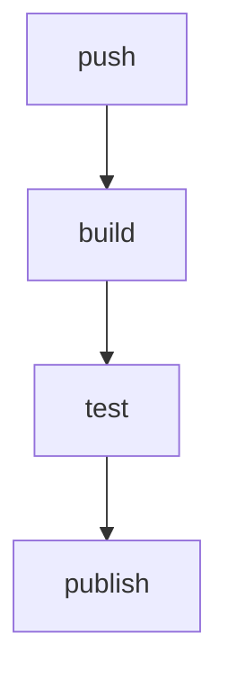

# Cours - Maîtriser le fichier de pipeline GitLab

> [!abstract] Objectifs
> - Lire un `.gitlab-ci.yml` inconnu (celui de CVAT ou le tien)
> - Ordonner des jobs avec les stages et `needs`
> - Choisir quand un job tourne avec `rules`
> - Passer des fichiers entre jobs avec les artefacts
> - Factoriser avec `extends`
> - Comprendre pourquoi les tests tournent dans l'image

**Prérequis :** [[YAML]] · [[Code de sortie]] · [[Cours - Construire et publier les images d'un projet avec GitLab CI]]

## 1. Ce qu'est un job, vraiment
Un job = un conteneur neuf (`image:`) où le [[Runner GitLab|runner]] lance les lignes de `script:` une par une. Dès qu'une ligne renvoie un [[Code de sortie]] non nul, le job échoue. Tout ce que le job crée disparaît à la fin, sauf les [[Artefacts GitLab CI|artefacts]] et ce qu'il pousse dans un registre.

## 2. Schéma : d'un push à une image testée

## 3. L'ordre
Les stages s'enchaînent ; `needs:` permet de partir plus tôt. Voir [[Pipeline GitLab CI]].

## 4. Le quand
`rules:` décide si un job est créé, automatique ou manuel, et si son échec bloque (`allow_failure`). Un job `skipped` n'a pas tourné : ce n'est ni un succès ni un échec. Voir [[Règles d'un job GitLab (rules)]].

## 5. Ne pas se répéter
Un job caché `.modele` et `extends:` évitent de recopier image, services et connexion au registre. Voir [[extends GitLab CI]].

## 6. Construire et tester des images
Construire une image demande un démon Docker : Docker-in-Docker ou Kaniko ([[Construire une image dans la CI]]). Les tests tournent ensuite **dans l'image** construite ([[Tester l'image, pas le dépôt]]).

## 7. Lire la CI d'un projet existant
1. Les `stages:` en haut : la grande structure.
2. Les `include:` : d'autres fichiers de CI ajoutés.
3. Les jobs cachés (`.nom`) : les modèles.
4. Pour un job précis : son `image:`, ses `rules:`, son `script:`.
5. En cas de doute : *Build > Pipeline editor > Full configuration* montre la version fusionnée.

## Mise en pratique
- Écris une pipeline à trois stages pour ton script Python : `lint` (vérifier que le script se lance avec `--help`), `test` (pytest), `build` (image Docker).
- Rends le stage `build` automatique sur `main` et manuel ailleurs.
- Garde le rapport pytest en artefact et affiche-le dans GitLab.

> [!warning] Erreurs fréquentes
> - Croire qu'un fichier créé dans un job existe dans le suivant sans artefact
> - Ajouter `allow_failure: true` pour « faire passer » un job au vert sans comprendre pourquoi il échoue
> - Redéfinir `script:` dans un job qui `extends` en pensant ajouter des lignes
> - Corriger un test dans le dépôt sans reconstruire l'image dans laquelle il tourne

## Résumé
En 3 phrases, avec mes mots.

## Concepts du cours
[[Pipeline GitLab CI]] · [[Règles d'un job GitLab (rules)]] · [[Artefacts GitLab CI]] · [[extends GitLab CI]] · [[Construire une image dans la CI]] · [[Tester l'image, pas le dépôt]]
