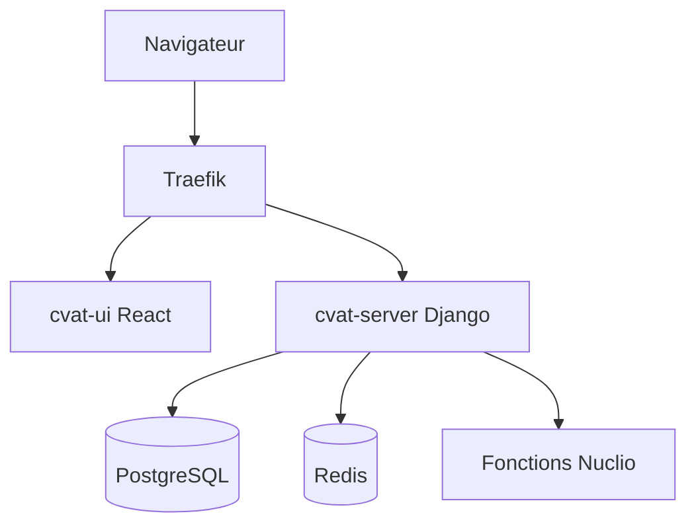

# Cours - Architecture d'une application

> [!abstract] Objectifs
> - Organiser une API en couches
> - Reconnaître MVC dans un framework
> - Choisir entre monolithe et services séparés

**Prérequis :** [[Cours - Organiser son code]] · [[Cours - Construire une API REST avec Express]]

## 1. Les étages d'une API
[[Architecture en couches]] : routes, services, dépôts. Les dépendances vont vers le bas.

## 2. Le classique des frameworks
[[MVC]] : modèle, vue, contrôleur. Django (donc CVAT) en est une variante.

## 3. Schéma de CVAT (simplifié)

## 4. Un seul bloc ou plusieurs services
[[Monolithe et microservices]] : commencer simple, découper seulement quand une partie doit vraiment vivre à part (comme une fonction Nuclio).

## Mise en pratique
- Fais l'[[Exercice - Lire et dessiner une architecture]].

> [!warning] Erreurs fréquentes
> - Découper en microservices dès le départ
> - Couches vides qui ne font que transmettre

## Résumé
En 3 phrases, avec mes mots.

## Concepts du cours
[[Architecture en couches]] · [[MVC]] · [[Monolithe et microservices]]
