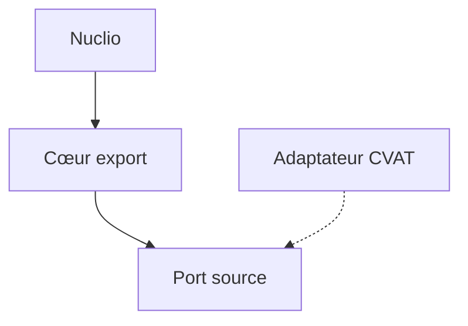

# Cours - Architectures modernes, hexagonale, événements et serverless

> [!abstract] Objectifs
> - Protéger le cœur métier avec les ports et adaptateurs
> - Comprendre la communication par événements et files de messages
> - Savoir ce qu'est une fonction serverless comme Nuclio
> - Situer une passerelle d'API, les douze facteurs et le cache

**Prérequis :** [[Cours - Organiser son code]], [[Cours - Architecture d'une application]], [[Module 13 - Docker]]

## Le fil rouge : ta fonction d'export CVAT
Tu vas écrire une fonction Nuclio qui lit des annotations dans CVAT et produit un PNG. Ce cours montre comment l'organiser pour qu'elle soit testable, déployable et rapide. Les mots changent selon les livres, les idées restent les mêmes.

## 1. Protéger le cœur : l'architecture hexagonale
En couches, le métier dépend souvent de la technique. L'[[Architecture hexagonale]] inverse cela : le code qui dessine le PNG ne connaît ni CVAT ni Nuclio. Il demande une « source d'annotations » (un **port**), et on lui donne une source CVAT en vrai, une source fichier en test (des **adaptateurs**).

## 2. Ne plus attendre : l'architecture événementielle
Un export peut prendre du temps. Plutôt que de faire patienter la requête, on publie un message « export demandé » dans une file, et un travailleur le traite : c'est l'[[Architecture événementielle]]. CVAT fait exactement ça avec Redis pour ses tâches lourdes.

## 3. Ne déployer qu'une fonction : le serverless
Avec le [[Serverless et FaaS]], tu écris `handler(context, event)` et la plateforme (Nuclio) gère le conteneur, le nombre de copies et l'arrêt. Conséquences : la fonction doit être **sans état**, et ce qui est lourd se charge une fois dans `init_context`.

## 4. Une seule porte d'entrée : la passerelle d'API
Quand il y a plusieurs services, une [[Passerelle d'API (API gateway)]] reçoit tout, vérifie l'authentification et route. Dans CVAT c'est Traefik.

## 5. Être déployable partout : les douze facteurs
L'[[Application douze facteurs]] résume les règles d'une appli « prête pour Docker » : configuration et secrets dans les variables d'environnement, logs sur la sortie standard, processus sans état, même image partout.

## 6. Aller plus vite : le cache
Un [[Cache applicatif]] évite de refaire un calcul ou un appel coûteux. La vraie difficulté est de savoir **quand l'effacer**.

## Choisir sans en faire trop
| Situation | Ce qui aide |
| --- | --- |
| Métier difficile à tester à cause d'un SDK | hexagonale (au moins un adaptateur) |
| Traitement long ou pics de charge | file de messages |
| Traitement ponctuel déclenché par un événement | fonction serverless |
| Plusieurs services exposés | passerelle d'API |
| Même calcul demandé souvent | cache |

Commence toujours simple et ajoute une de ces pièces quand un problème réel l'exige.

## Mise en pratique
- Fais l'[[Exercice - Concevoir la fonction d'export CVAT]]
- Fais l'[[Exercice - Rendre une application déployable et rapide]]

> [!warning] Erreurs fréquentes
> - Ajouter file de messages, passerelle et cache à un petit projet qui n'en a pas besoin
> - Importer le SDK ou le framework dans le cœur métier
> - Garder un état en mémoire dans une fonction serverless
> - Mettre un secret dans le code au lieu d'une variable d'environnement
> - Mettre un cache sans prévoir son invalidation

## Résumé
En 3 phrases, avec mes mots.

## Concepts du cours
[[Architecture hexagonale]] · [[Architecture événementielle]] · [[Serverless et FaaS]] · [[Passerelle d'API (API gateway)]] · [[Application douze facteurs]] · [[Cache applicatif]]
