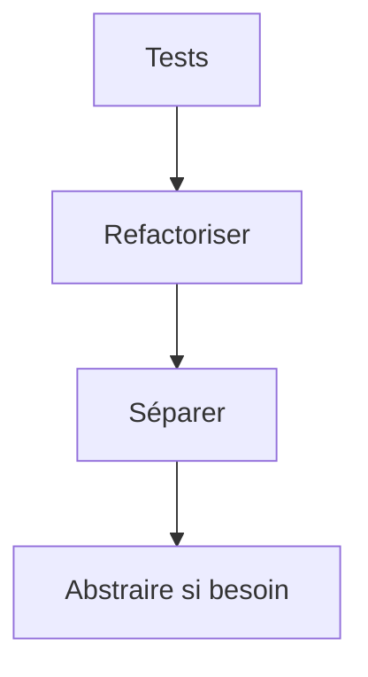

# Cours - Organiser son code

> [!abstract] Objectifs
> - Découper le code selon les responsabilités
> - Appliquer DRY, KISS et YAGNI avec mesure
> - Refactoriser en sécurité
> - Connaître SOLID et les patrons les plus courants

**Prérequis :** [[Cours - Pourquoi et comment tester]] · [[Cours - Fonctions, modules et erreurs]]

## 1. Une raison de changer par morceau
[[Séparation des responsabilités]] : présentation, métier, accès aux données.

## 2. Le bon sens
[[Principes DRY, KISS et YAGNI]] : pas de répétition de connaissance, pas de complication, pas d'« au cas où ».

## 3. Schéma

## 4. Améliorer sans casser
[[Refactorisation]] : petites étapes, tests verts, un commit par étape.

## 5. Pour aller plus loin
[[Principes SOLID]] (surtout l'inversion des dépendances) et les [[Design pattern|design patterns]] courants : stratégie, adaptateur, observateur, dépôt.

## Mise en pratique
- Fais l'[[Exercice - Refactoriser un script en couches]].

> [!warning] Erreurs fréquentes
> - Abstraire trop tôt
> - Refactoriser sans tests
> - Mélanger refactorisation et nouvelle fonctionnalité dans un commit

## Résumé
En 3 phrases, avec mes mots.

## Concepts du cours
[[Séparation des responsabilités]] · [[Principes DRY, KISS et YAGNI]] · [[Refactorisation]] · [[Principes SOLID]] · [[Design pattern]]
