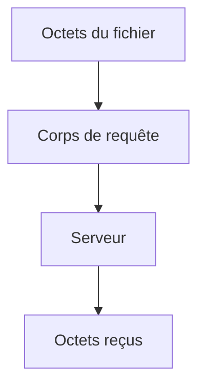

# Cours - Envoyer et recevoir des fichiers par HTTP

> [!abstract] Objectifs
> - Savoir qu'un zip ou une image, pour Python, ce sont des **octets** (`bytes`), pas du texte
> - Fabriquer et lire un zip **en mémoire**, sans fichier temporaire
> - Envoyer un fichier dans une requête, de la façon que le serveur attend (multipart, corps brut ou JSON)
> - Recevoir une image ou un zip et l'enregistrer
> - Choisir la bonne bibliothèque, y compris quand pip est bloqué au travail

**Prérequis :** [[Cours - Manipuler des fichiers et des archives]] · [[Appeler une API HTTP (requests)]] · [[HTTP]] · [[En-tête HTTP]]

## 1. Pourquoi tu en as besoin maintenant
Dans ton POC CVAT, les fichiers voyagent par le réseau :
1. ton script ou ta fonction **télécharge** l'export zip de CVAT ;
2. il lit le zip (annotations + images) ;
3. il génère un PNG ;
4. la fonction Nuclio **renvoie** ce PNG au bouton React.

Aucune de ces étapes n'a besoin d'écrire sur le disque. Tout ce cours tient en une idée : **un fichier, c'est une suite d'octets, et HTTP sait transporter des octets**.

## 2. Schéma : le trajet d'un fichier

## 3. Texte ou octets
| | Texte | Octets |
| --- | --- | --- |
| Type Python | `str` | `bytes` |
| Exemple | `"bonjour"` | `b"PK\x03\x04..."` (un zip), `b"\x89PNG..."` (une image) |
| Ouvrir un fichier | `open(f, "r")` / `"w"` | `open(f, "rb")` / `"wb"` |
| Dans une réponse requests | `r.text` | `r.content` |
| Passer de l'un à l'autre | `.encode("utf-8")` → | ← `.decode("utf-8")` |

Un zip ou une image se manipule **toujours** en octets. Les premiers octets disent souvent ce que c'est : `PK` pour un zip, `\x89PNG` pour un PNG. Voir [[Binaire et octet]].

## 4. Un fichier en mémoire
`io.BytesIO` est un faux fichier binaire rangé en mémoire. On le donne à `zipfile` à la place d'un nom de fichier :
- **fabriquer** : `ZipFile(BytesIO(), "w")`, puis `getvalue()` pour récupérer les octets à envoyer ;
- **lire** : `ZipFile(BytesIO(octets_recus))`, puis `namelist()` et `read("annotations.xml")`.

Détails : [[Fichier en mémoire (io.BytesIO)]].

## 5. Trois façons d'envoyer un fichier
C'est **le serveur** qui choisit. Sa documentation (ou son [[OpenAPI]]) dit laquelle il attend.

| Le serveur attend… | Tu envoies | Exemple réel |
| --- | --- | --- |
| un formulaire `multipart/form-data` avec un champ nommé | `requests.post(url, files={"champ": (nom, octets, type)})` | importer un jeu de données dans CVAT |
| le fichier seul dans le corps | `data=octets` + `Content-Type: image/png` | une fonction qui reçoit une image brute |
| du JSON | `json={"image": base64}` ([[Base64]]) | les fonctions Nuclio de détection de CVAT |

Et pour **répondre** avec un fichier (ta fonction Nuclio) : les octets dans le corps, et le bon `Content-Type` (`image/png`).

Détails : [[Envoyer et recevoir un fichier en HTTP]].

## 6. Quelle bibliothèque ?
| Bibliothèque | Installée avec Python ? | Quand l'utiliser |
| --- | --- | --- |
| `urllib.request` | ✅ oui | pip bloqué, fonction sans dépendance, appel simple ([[Appeler une API sans pip (urllib.request)]]) |
| `requests` | ❌ `pip install requests` | le choix par défaut : lisible, multipart facile ([[Appeler une API HTTP (requests)]]) |
| `httpx` | ❌ `pip install httpx` | comme requests, avec en plus l'asynchrone. Inutile pour l'instant |
| `zipfile`, `io`, `base64` | ✅ oui | fabriquer, lire et encoder les fichiers |
| `Pillow` (`PIL`) | ❌ `pip install pillow` | **fabriquer ou modifier** une image (dessiner, redimensionner). Pas pour l'envoyer |

> [!tip] Au travail, pip est bloqué par le proxy
> Deux solutions :
> 1. **Sans dépendance** : `urllib.request`. Le multipart y est pénible, donc préfère un corps brut quand le serveur l'accepte.
> 2. **Le PyPI du Nexus** : le [[Nexus]] de l'entreprise sert aussi de miroir à PyPI. Demande l'adresse à un collègue, puis `pip install --index-url <adresse du Nexus>/simple requests`. Voir [[Fiche - Images Docker au travail via le Nexus]].

## 7. Le piège du proxy sur localhost
Si `HTTP_PROXY` ou `HTTPS_PROXY` sont définis (fréquent au travail), requests et urllib envoient **aussi** tes appels à `localhost` vers le proxy. Tu obtiens alors un 407 ou une page HTML du proxy au lieu de ton serveur. Solution : `export NO_PROXY=localhost,127.0.0.1`. Voir [[Proxy]].

## Mise en pratique
Le mini-projet [[Projet - Envoyer un zip ou une image en Python]] : un serveur de test est fourni, tu écris le script qui lui envoie un zip et une image, de trois façons, puis qui en reçoit.

> [!warning] Erreurs fréquentes
> - Ouvrir un zip ou une image en `"r"` au lieu de `"rb"`
> - Utiliser `r.text` au lieu de `r.content` pour une image
> - Écrire `Content-Type: multipart/form-data` à la main (il manque le `boundary`)
> - Envoyer `data=octets` à un serveur qui attend un formulaire multipart
> - Oublier `.decode("ascii")` après `base64.b64encode`
> - Avec urllib, oublier qu'une réponse 4xx ou 5xx devient une exception

## Résumé
En 3 phrases, avec mes mots.

## Concepts du cours
[[Fichier en mémoire (io.BytesIO)]] · [[Envoyer et recevoir un fichier en HTTP]] · [[Appeler une API sans pip (urllib.request)]] · [[Base64]]
