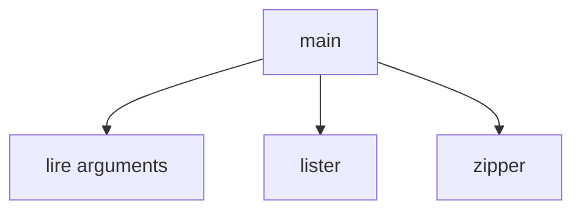

# Cours - Fonctions, modules et erreurs

> [!abstract] Objectifs
> - Découper un script en fonctions
> - Utiliser la bibliothèque standard et ses propres fichiers avec import
> - Lire un traceback et gérer une erreur prévue
> - Faire sortir un script en échec quand il échoue

**Prérequis :** [[Cours - Python, premiers pas]]

## 1. Pourquoi découper
Un script qui grossit devient illisible. On le découpe en [[Fonction|fonctions]] qui font **une seule chose** et portent un nom clair. Le script principal devient une suite d'étapes lisible comme une recette.

## 2. Schéma : un script bien rangé


## 3. Définir et appeler
```python
def extension(nom: str) -> str:
    return nom.rsplit(".", 1)[-1].lower()

print(extension("Photo.PNG"))   # png
```
Une fonction **reçoit** des paramètres et **renvoie** un résultat avec `return`. Elle ne devrait pas dépendre de variables définies ailleurs : tout ce dont elle a besoin passe par ses paramètres.

## 4. Importer
```python
import sys                     # bibliothèque standard
from pathlib import Path       # un nom précis d'un module
from outils import extension   # ton propre fichier outils.py
```
Voir [[Module et import Python]]. Garde le point d'entrée dans un bloc `if __name__ == "__main__":`.

## 5. Quand ça casse
Une [[Exception]] arrête le script et affiche un traceback. Méthode : lire **la dernière ligne** (type et message), puis remonter jusqu'à la première ligne qui appartient à **ton** fichier.

On attrape seulement les erreurs **prévues**, et on sort en échec avec un [[Code de sortie]] non nul :
```python
import sys
from pathlib import Path

def main() -> int:
    if len(sys.argv) < 2:
        print("Usage : python main.py <dossier>", file=sys.stderr)
        return 2
    dossier = Path(sys.argv[1])
    if not dossier.is_dir():
        print(f"Dossier introuvable : {dossier}", file=sys.stderr)
        return 1
    print(f"Traitement de {dossier}")
    return 0

if __name__ == "__main__":
    sys.exit(main())
```
Ce squelette (`main()` qui renvoie un code, `sys.exit(main())`) est une bonne base pour tous tes scripts.

## Mise en pratique
Le mini-projet [[Projet - Faire le ménage dans ses conteneurs Docker]], les étapes 04 à 06 : un vrai petit outil qui lit la liste de tes conteneurs Docker et te prépare le ménage.

> [!warning] Erreurs fréquentes
> - Afficher un résultat avec `print` dans la fonction au lieu de le renvoyer avec `return`
> - Écrire `except Exception: pass` : l'erreur disparaît et le script ne fait rien
> - Appeler son fichier `zipfile.py` ou `shutil.py` : il cache le module de Python
> - Lire un traceback par le haut au lieu de partir de la dernière ligne

## Résumé
En 3 phrases, avec mes mots.

## Concepts du cours
[[Fonction]] · [[Module et import Python]] · [[Exception]] · [[Code de sortie]]
