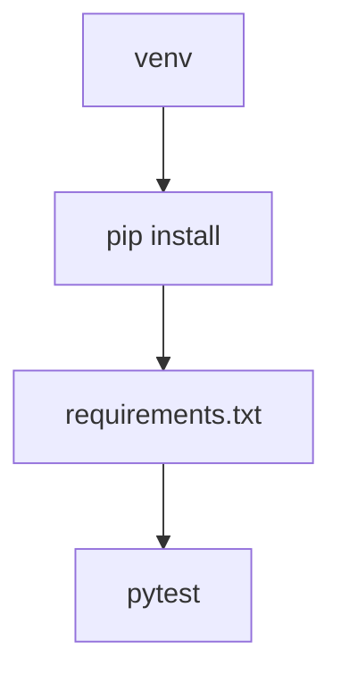

# Cours - Installer des dépendances et tester

> [!abstract] Objectifs
> - Isoler les dépendances d'un projet dans un venv
> - Installer et figer des paquets avec pip et requirements.txt
> - Écrire et lancer des tests avec pytest
> - Utiliser une bibliothèque externe : requests

**Prérequis :** [[Cours - Fonctions, modules et erreurs]]

## 1. Bibliothèque standard ou paquet externe
`pathlib`, `zipfile`, `json` sont livrés avec Python. requests ou pytest sont des **paquets externes** : il faut les installer avec [[pip]].

## 2. Schéma


## 3. Un environnement par projet
On crée un [[Environnement virtuel Python]] dans le dossier du projet (`python -m venv .venv`), on l'active, puis on installe. Le dossier `.venv` va dans `.gitignore`.

## 4. Décrire ses dépendances
`requirements.txt` liste les paquets et leurs versions. Il est commité ; c'est lui que lira le [[Dockerfile]] (`RUN pip install -r requirements.txt`). En entreprise, pip passe par le [[Nexus]] ou un [[Proxy]].

## 5. Tester
[[pytest]] lance les fonctions `test_…` et vérifie les `assert`. Un bon test : un nom qui dit ce qu'il vérifie, une préparation, une action, une vérification.
```python
def test_zip_ne_contient_que_les_png(tmp_path):
    (tmp_path / "a.png").write_bytes(b"x")
    (tmp_path / "b.txt").write_text("x")
    # action : appeler ta fonction de zip
    # vérification : assert sur la liste des noms dans l'archive
```

## 6. Une bibliothèque externe : requests
[[Appeler une API HTTP (requests)|requests]] appelle des API web en quelques lignes. C'est le paquet externe le plus installé de Python ; il sert aussi à récupérer les annotations de CVAT. La suite des usages courants est dans [[Cours - Python au quotidien]].

## Mise en pratique
- Crée un projet `essai-zip/` avec un venv, installe pytest et requests, génère `requirements.txt`.
- Écris trois tests pour tes fonctions du cours précédent, dont un avec `tmp_path`.
- Avec requests, appelle `https://api.github.com/repos/python/cpython` et affiche le nombre d'étoiles.

> [!warning] Erreurs fréquentes
> - Installer les paquets sans activer le venv : ils partent dans le Python de la machine
> - Commiter le dossier `.venv`
> - Oublier de mettre à jour `requirements.txt` après un `pip install` : l'image Docker n'aura pas le paquet
> - Croire qu'un test `skipped` est un test réussi

## Résumé
En 3 phrases, avec mes mots.

## Concepts du cours
[[Environnement virtuel Python]] · [[pip]] · [[pytest]] · [[Appeler une API HTTP (requests)]]
