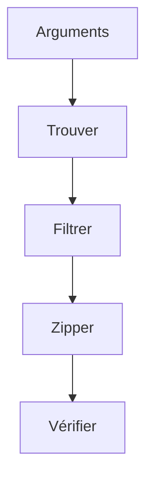

# Cours - Manipuler des fichiers et des archives

> [!abstract] Objectifs
> - Trouver des fichiers dans un dossier et ses sous-dossiers
> - Lire et écrire des fichiers texte, JSON et binaires
> - Copier, déplacer, supprimer, archiver
> - Créer et lire une archive zip en contrôlant son contenu
> - Recevoir le dossier à traiter en argument du script

**Prérequis :** [[Cours - Fonctions, modules et erreurs]] · [[Système de fichiers]]

## 1. Les outils de la boîte
Tout est dans la bibliothèque standard, rien à installer :

| Module | Rôle |
| --- | --- |
| `pathlib` | représenter et explorer des chemins ([[Chemin de fichier en Python (pathlib)]]) |
| `open`, `read_text`… | lire et écrire ([[Lire et écrire un fichier]]) |
| `shutil` | copier, déplacer, supprimer, archiver vite ([[Copier et déplacer des fichiers (shutil)]]) |
| `zipfile` | contrôle fin d'une archive zip ([[Archive zip (zipfile)]]) |
| `argparse` | recevoir les paramètres ([[Arguments de ligne de commande]]) |

## 2. Schéma : le trajet d'un script de fichiers

## 3. Trouver et filtrer
`Path(dossier).rglob("*")` parcourt tout l'arbre. On filtre avec `.is_file()`, `.suffix`, `.stat().st_size`. Pense dès le départ aux cas limites : dossier vide, dossier inexistant, fichiers cachés.

## 4. Lire et écrire
Texte avec un encodage (`utf-8`), binaire pour le reste. Toujours `with open(...)` pour fermer proprement.

## 5. Archiver : deux niveaux
- **Rapide** : `shutil.make_archive("export", "zip", root_dir=dossier)` zippe tout.
- **Contrôlé** : `zipfile.ZipFile(..., "w", ZIP_DEFLATED)` et un `z.write(f, arcname=...)` par fichier choisi.

La notion clé est `arcname` : le chemin **dans** l'archive, en général `f.relative_to(dossier)`.

## 6. Sécurité de base
- Ne jamais écrire l'archive dans le dossier source.
- Avant tout `rmtree` ou `unlink`, afficher ce qui va être supprimé ; prévoir une option `--dry-run` (« à blanc ») qui affiche sans rien faire.
- Sortir avec un code non nul si quelque chose a échoué ([[Code de sortie]]).

## 7. Ce que tu vas assembler toi-même
Ton script de projet combine ces briques. Avant de coder, écris en français (en commentaires) les étapes de **ton** besoin : quels fichiers, quels filtres, quel nom d'archive, que faire des originaux, que faire en cas d'erreur. Chaque commentaire deviendra une fonction.

## Mise en pratique
- Prépare un dossier de test : 3 `.png`, 2 `.txt`, un sous-dossier avec 1 `.png`, un fichier vide.
- Écris un script qui affiche, pour chaque fichier, son chemin relatif, son extension et sa taille.
- Ajoute la création d'un zip contenant **seulement** les `.png`, en gardant les sous-dossiers.
- Ajoute `argparse` (`dossier`, `--sortie`, `--extension`) et une option `--dry-run`.
- Écris un test pytest avec `tmp_path` qui vérifie le contenu de l'archive.

> [!warning] Erreurs fréquentes
> - Écrire les chemins avec des `\` en dur : le script casse dans un conteneur Linux
> - Oublier `arcname` : l'archive contient le chemin complet du disque
> - Créer l'archive dans le dossier qu'on zippe
> - Supprimer les originaux avant d'avoir vérifié que l'archive est correcte

## Résumé
En 3 phrases, avec mes mots.

## Concepts du cours
[[Chemin de fichier en Python (pathlib)]] · [[Lire et écrire un fichier]] · [[Copier et déplacer des fichiers (shutil)]] · [[Archive zip (zipfile)]] · [[Arguments de ligne de commande]]
