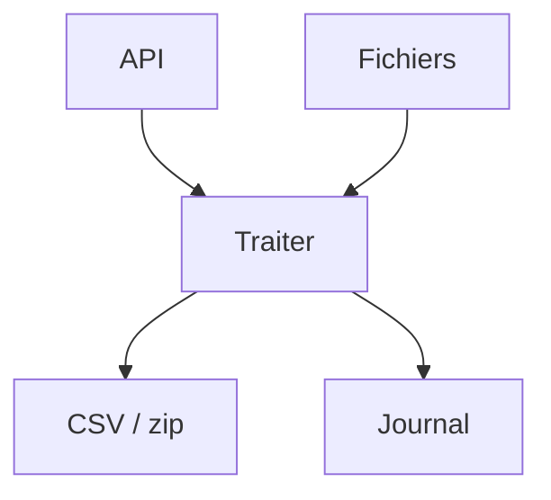

# Cours - Python au quotidien

> [!abstract] Objectifs
> - Appeler une API web et exploiter sa réponse JSON
> - Produire et lire des tableaux CSV
> - Manipuler des dates (noms de fichiers, filtres)
> - Journaliser proprement au lieu d'utiliser print
> - Lancer d'autres programmes depuis Python
> - Extraire des informations d'un texte avec une regex

**Prérequis :** [[Cours - Manipuler des fichiers et des archives]] · [[Cours - Installer des dépendances et tester]]

## 1. Ce que l'on fait le plus souvent avec Python
En entreprise, un script Python sert surtout à **automatiser** : récupérer des données d'une API, les transformer, produire un fichier (CSV, JSON, zip), le tout en laissant un journal. Les briques de ce cours reviennent dans presque tous les scripts.

## 2. Schéma : un script d'automatisation type

## 3. Récupérer des données
[[Appeler une API HTTP (requests)]] : `requests.get(url, timeout=10)`, `raise_for_status()`, `.json()`.

## 4. Produire un tableau
[[Lire et écrire du CSV]] : `csv.DictWriter` pour un fichier ouvrable dans Excel.

## 5. Dater
[[Dates et heures (datetime)]] : horodater les fichiers produits (`export_2026-11-06.csv`) et filtrer par ancienneté.

## 6. Garder une trace
[[Journaliser avec logging]] : un niveau (INFO, WARNING, ERROR), une date, un format, réglable par variable d'environnement.

## 7. S'appuyer sur d'autres outils
[[Lancer une commande (subprocess)]] : appeler `git`, `docker` ou `zip` avec une liste d'arguments et `check=True`.

## 8. Fouiller du texte
[[Expressions régulières (re)]] : extraire dates, codes, versions d'un log.

## 9. Lire sa configuration
Un script qui parle à un service (CVAT, une base) a besoin d'une adresse et d'identifiants. Ils ne vont pas dans le code : le code lit `os.environ`, et en local, [[Charger un fichier .env (python-dotenv)]] remplit `os.environ` depuis un fichier `.env` ignoré par Git ([[Secret et fichier .env]]).

## Mise en pratique
- Fais l'[[Exercice - Appeler une API et produire un CSV]].
- Fais l'[[Exercice - Un script qui journalise, lance des commandes et lit des logs]].
- Fais l'[[Exercice - Charger les identifiants CVAT depuis un .env]].

> [!warning] Erreurs fréquentes
> - Oublier `timeout=` dans requests : le script peut attendre indéfiniment
> - Lire un CSV et oublier que toutes les valeurs sont du texte
> - Comparer une date avec fuseau horaire et une date sans
> - Utiliser `shell=True` avec des données venant de l'extérieur

## Résumé
En 3 phrases, avec mes mots.

## Concepts du cours
[[Appeler une API HTTP (requests)]] · [[Lire et écrire du CSV]] · [[Dates et heures (datetime)]] · [[Journaliser avec logging]] · [[Lancer une commande (subprocess)]] · [[Expressions régulières (re)]] · [[Charger un fichier .env (python-dotenv)]]
