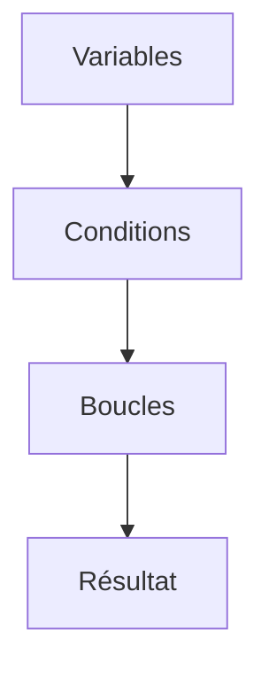

# Cours - Python, premiers pas

> [!abstract] Objectifs
> - Installer Python et lancer un script
> - Ranger des valeurs dans des variables et connaître leur type
> - Prendre des décisions avec if et répéter avec for
> - Regrouper des valeurs dans une liste ou un dictionnaire

**Prérequis :** [[Terminal]] · [[Cours - Ce que tout programme reçoit et renvoie]]

## 1. Installer et lancer
1. Installe Python 3 depuis python.org (sous Windows, coche **Add Python to PATH**).
2. Vérifie : `python --version` (ou `py --version`).
3. Crée un fichier `bonjour.py`, écris `print("Bonjour")`, lance `python bonjour.py`.

Le programme `python` est l'**interpréteur** : il lit ton fichier de haut en bas et exécute chaque ligne. Voir [[Python]] et la commande [[python script.py]].

## 2. Schéma : de quoi est fait un script


## 3. Ranger des valeurs
Une variable donne un nom à une valeur : `dossier = "photos"`. Chaque valeur a un type (`str`, `int`, `bool`…) qui décide de ce qu'on peut en faire. Voir [[Variables et types en Python]].
```python
dossier = "photos"
nb = 3
print(f"{nb} fichiers dans {dossier}")
```

## 4. Décider
```python
if nb == 0:
    print("Rien à faire")
else:
    print("On zippe")
```
Le bloc est délimité par **l'indentation** (4 espaces). Voir [[Condition (if)]].

## 5. Répéter
```python
for nom in ["a.png", "b.txt"]:
    print(nom)
```
Voir [[Boucle (for, while)]].

## 6. Regrouper
Une liste garde un ordre, un dictionnaire associe une clé à une valeur. Voir [[Liste et dictionnaire]].
```python
fichiers = ["a.png", "b.txt"]
tailles = {"a.png": 120}
```

## 7. Le programme complet
```python
fichiers = ["a.png", "b.txt", "c.png", "notes.md"]
compte = {}

for nom in fichiers:
    ext = nom.split(".")[-1]          # "png", "txt"…
    compte[ext] = compte.get(ext, 0) + 1

for ext, nb in compte.items():
    print(f"{ext} : {nb}")
```
Lis-le ligne par ligne et dis à voix haute ce que fait chacune avant de le lancer.

## Mise en pratique
Le mini-projet [[Projet - Faire le ménage dans ses conteneurs Docker]], les étapes 01 à 03 : un vrai petit outil qui lit la liste de tes conteneurs Docker et te prépare le ménage.

> [!warning] Erreurs fréquentes
> - Oublier les deux-points `:` à la fin d'un `if`, `for` ou `def`
> - Indenter avec un mélange d'espaces et de tabulations
> - Confondre `=` (affecter) et `==` (comparer)
> - Compter les positions d'une liste à partir de 1 au lieu de 0

## Résumé
En 3 phrases, avec mes mots.

## Concepts du cours
[[Python]] · [[Variables et types en Python]] · [[Condition (if)]] · [[Boucle (for, while)]] · [[Liste et dictionnaire]]
