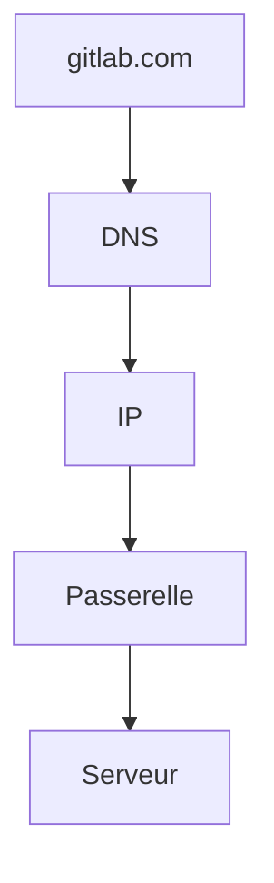

# Cours - Adresses IP, DNS et routage

> [!abstract] Objectifs
> - Lire une adresse IP et savoir si elle est privée ou publique
> - Expliquer comment un nom devient une adresse
> - Suivre le chemin d'un paquet jusqu'à un serveur

**Prérequis :** [[Internet]] · [[Client-serveur]]

## 1. Une adresse par machine
Chaque interface réseau a une [[Adresse IP]]. `127.0.0.1` = toi-même, `192.168.x.x` = ton réseau local, le reste = Internet.

## 2. Schéma : taper une URL

## 3. Des noms plutôt que des numéros
Le [[DNS]] traduit `gitlab.com` en adresse. Le fichier hosts court-circuite le DNS. Docker compose a son propre DNS pour les noms de services.

## 4. Sortir de son réseau
La passerelle (la box) envoie tout ce qui n'est pas local vers Internet ; le NAT remplace ton IP privée par l'IP publique ([[Routage et NAT]]). Le VPN te place dans le réseau de l'entreprise.

## 5. Diagnostiquer dans l'ordre
1. Ai-je une IP et une passerelle ? (`ip addr`, `ip route` / `ipconfig`)
2. Le nom se résout-il ? (`nslookup`)
3. La machine répond-elle ? (`ping`, sans garantie : beaucoup de serveurs ignorent le ping)
4. Le port est-il ouvert ? (`Test-NetConnection`, `nc -zv`)
5. Le service répond-il ? (`curl -v`)

## Mise en pratique
- Fais l'[[Exercice - Diagnostiquer une connexion réseau]].

> [!warning] Erreurs fréquentes
> - Conclure « le serveur est en panne » alors que c'est le DNS qui ne résout pas
> - Croire qu'un `ping` qui échoue veut dire que le serveur est éteint (le ping est souvent bloqué)
> - Utiliser `localhost` dans un conteneur pour joindre ta machine

## Résumé
En 3 phrases, avec mes mots.

## Concepts du cours
[[Adresse IP]] · [[DNS]] · [[Routage et NAT]]
