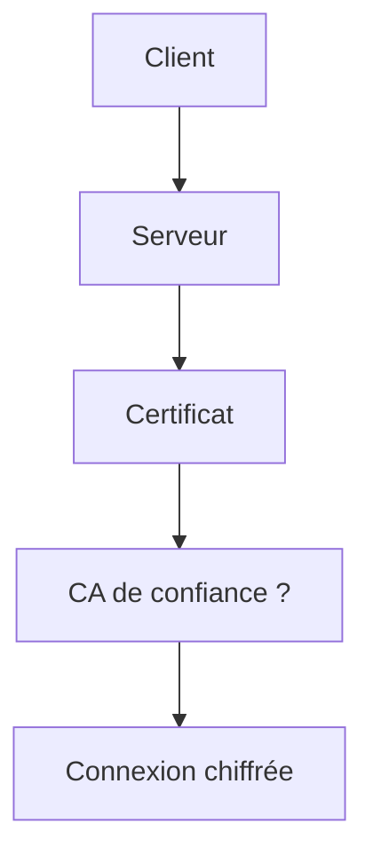

# Cours - HTTPS, TLS et certificats

> [!abstract] Objectifs
> - Expliquer ce que protège HTTPS
> - Lire un certificat et ses dates
> - Comprendre et corriger une erreur de certificat en entreprise sans désactiver la sécurité

**Prérequis :** [[HTTP]] · [[Cours - TCP, UDP, ports et pare-feu]]

## 1. Pourquoi chiffrer
Entre toi et le serveur, des dizaines de machines voient passer les données. [[HTTPS et TLS]] les rendent illisibles et inmodifiables.

## 2. Schéma

## 3. Le certificat
Un [[Certificat]] lie un nom à une clé publique, signé par une autorité de certification. Ta machine a une liste de CA de confiance. Trois vérifications : la signature remonte à une CA connue, le nom correspond, la date est valide.

## 4. Clé publique, clé privée
Ce qui est chiffré avec la clé publique ne se déchiffre qu'avec la clé privée ; ce qui est signé avec la clé privée se vérifie avec la publique. La clé privée ne quitte jamais le serveur. Même principe pour les [[Clé SSH|clés SSH]].

## 5. En entreprise
Le proxy déchiffre souvent le trafic pour l'inspecter, avec sa propre CA. Résultat : `unable to get local issuer certificate` dans pip, git, npm, Docker, Python. La solution est d'**ajouter la CA de l'entreprise** au bon magasin, jamais de désactiver la vérification.

## 6. Obtenir un certificat
Pour un serveur public : Let's Encrypt (gratuit, automatique ; Traefik sait le faire). Pour un serveur interne : la CA de l'entreprise. Pour un test local : un certificat auto-signé.

## Mise en pratique
- Fais l'[[Exercice - Lire et faire confiance à un certificat]].

> [!warning] Erreurs fréquentes
> - Désactiver la vérification TLS (`-k`, `verify=False`) au lieu d'installer la CA
> - Commiter une clé privée (`.key`) dans un dépôt
> - Oublier qu'un certificat expire : le service tombe du jour au lendemain

## Résumé
En 3 phrases, avec mes mots.

## Concepts du cours
[[HTTPS et TLS]] · [[Certificat]]
