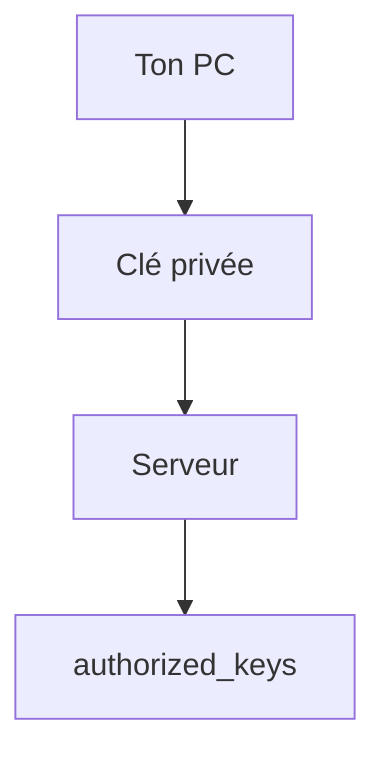

# Cours - SSH, se connecter à un serveur

> [!abstract] Objectifs
> - Se connecter à un serveur et y lancer des commandes
> - Créer et utiliser une clé SSH
> - Copier des fichiers et configurer des raccourcis

**Prérequis :** [[Cours - Bash, les commandes essentielles]]

## 1. Un terminal à distance
[[SSH]] ouvre un shell sur un serveur. Tout ce que tu as appris en Bash s'applique, mais **sur une autre machine** : regarde toujours l'invite (`oumar@serveur:~$`).

## 2. Schéma

## 3. Les clés
Crée une [[Clé SSH]] (`ssh-keygen -t ed25519`), donne la partie publique au serveur (`ssh-copy-id`) ou à GitLab. La clé privée reste dans `~/.ssh`, en `chmod 600`.

## 4. Les usages
- `ssh user@hôte` : se connecter ; `exit` pour revenir.
- `ssh user@hôte "commande"` : lancer une commande.
- `scp` : copier des fichiers.
- `~/.ssh/config` : des raccourcis (`ssh cvat`).
- Git en SSH : `git@gitlab.com:equipe/projet.git`.

## 5. Sécurité
Vérifie l'empreinte à la première connexion ; prends au sérieux l'avertissement « identification has changed ».

## Mise en pratique
- Fais l'[[Exercice - Se connecter en SSH avec une clé]].

> [!warning] Erreurs fréquentes
> - Partager ou commiter sa clé privée
> - Taper une commande destructrice en croyant être sur son poste alors qu'on est sur le serveur
> - Clé privée avec des droits trop ouverts : SSH la refuse

## Résumé
En 3 phrases, avec mes mots.

## Concepts du cours
[[SSH]] · [[Clé SSH]]
