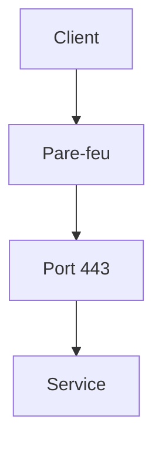

# Cours - TCP, UDP, ports et pare-feu

> [!abstract] Objectifs
> - Comprendre ce qu'est une connexion TCP
> - Savoir quels ports écoutent sur une machine
> - Distinguer « refusé » et « délai dépassé »
> - Ouvrir un port dans un pare-feu

**Prérequis :** [[Cours - Adresses IP, DNS et routage]]

## 1. Le transport
Une adresse IP amène à la machine ; [[TCP et UDP]] transportent les données jusqu'au bon programme, identifié par son [[Port]].

## 2. Schéma

## 3. Qui écoute ?
`ss -tlnp` (Linux) ou `netstat -ano` (Windows) : chaque ligne = un programme qui attend des connexions. Regarde l'adresse : `127.0.0.1:5432` = local seulement ; `0.0.0.0:5432` = toutes les interfaces.

## 4. Lire les échecs
- **refused** : la machine répond, rien n'écoute sur ce port.
- **timeout** : rien ne répond ; souvent un [[Pare-feu]].

## 5. Le pare-feu
Il autorise ou bloque par port et par sens. Sur un serveur Ubuntu : `ufw`. En entreprise, des pare-feu réseau filtrent aussi entre les zones (poste, serveurs, Internet).

## Mise en pratique
- Fais la partie « ports » de l'[[Exercice - Diagnostiquer une connexion réseau]].

> [!warning] Erreurs fréquentes
> - Faire écouter un serveur sur `127.0.0.1` et s'étonner qu'il soit injoignable depuis une autre machine
> - Ouvrir tous les ports « pour tester » et oublier de les refermer

## Résumé
En 3 phrases, avec mes mots.

## Concepts du cours
[[TCP et UDP]] · [[Port]] · [[Pare-feu]]
