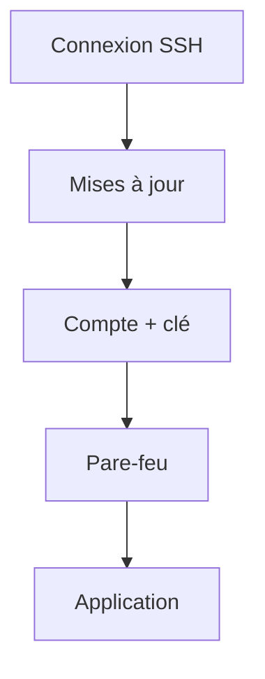

# Cours - Administrer un serveur Linux

> [!abstract] Objectifs
> - Préparer un serveur neuf de façon sûre
> - Gérer comptes et groupes
> - Surveiller la place disque, la mémoire et les processus

**Prérequis :** [[Cours - SSH, se connecter à un serveur]] · [[Cours - Services, journaux et tâches planifiées]]

## 1. Les premiers gestes sur un serveur neuf
1. Se connecter en [[SSH]] ; mettre à jour (`sudo apt update && sudo apt upgrade`).
2. Créer un compte personnel ([[Utilisateur et groupe]]), lui donner `sudo`, installer sa [[Clé SSH]].
3. Interdire la connexion root et par mot de passe (`/etc/ssh/sshd_config` : `PermitRootLogin no`, `PasswordAuthentication no`), redémarrer `ssh`.
4. Activer le [[Pare-feu]] en n'ouvrant que le nécessaire (22, 80, 443).
5. Installer Docker, ajouter le compte au groupe `docker`.

## 2. Schéma


## 3. Surveiller la machine
```bash
df -h            # disque
free -h          # mémoire
top              # processus (htop : plus lisible)
uptime           # charge
docker system df # place prise par Docker
```

## 4. Bonnes habitudes
- Une modification de config = une copie avant (`cp fichier fichier.bak`).
- Garder une session SSH ouverte quand on touche à SSH ou au pare-feu, pour ne pas s'enfermer dehors.
- Noter ce qu'on fait (dans ton coffre !).

## Mise en pratique
- Fais l'[[Exercice - Préparer un serveur Linux]] (WSL ou une VM).

> [!warning] Erreurs fréquentes
> - Couper l'accès SSH par mot de passe avant d'avoir testé la clé : on se retrouve enfermé dehors
> - Activer le pare-feu sans autoriser le port 22 sur une machine distante
> - Tout faire en root

## Résumé
En 3 phrases, avec mes mots.

## Concepts du cours
[[Utilisateur et groupe]] · [[SSH]] · [[Pare-feu]] · [[Gestionnaire de paquets]]
