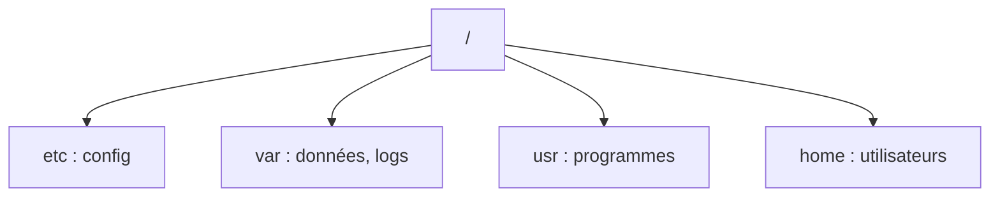

# Cours - Se repérer dans un système Linux

> [!abstract] Objectifs
> - Savoir où chercher programmes, configuration, données et journaux
> - Utiliser les liens symboliques
> - Archiver et restaurer un dossier

**Prérequis :** [[Cours - Bash, les commandes essentielles]] · [[Cours - Linux, utilisateurs, permissions et paquets]]

## 1. Un seul arbre
Tout part de `/`. Les dossiers ont un rôle fixe : configuration dans `/etc`, données et journaux dans `/var`, programmes dans `/usr/bin`, tes fichiers dans `~`. Voir [[Arborescence Linux]].

## 2. Schéma


## 3. Trouver
```bash
which python3                       # où est un programme
find /etc -name "*.conf" 2>/dev/null
grep -rn "Port" /etc/ssh/sshd_config
du -sh /var/lib/docker              # qui prend la place
df -h                               # place libre
```

## 4. Raccourcis
Les [[Lien symbolique|liens symboliques]] pointent vers un autre chemin : `ln -s cible lien`.

## 5. Sauvegarder
[[Archive tar et compression]] : `tar -czf` pour créer, `tar -tzf` pour lister, `tar -xzf` pour extraire.

## Mise en pratique
- Fais l'[[Exercice - Explorer et sauvegarder un système Linux]].

> [!warning] Erreurs fréquentes
> - Modifier un fichier de `/etc` sans en faire de copie avant
> - Disque plein : chercher avec `du`, pas supprimer au hasard
> - Confondre `tar -c` et `tar -x`

## Résumé
En 3 phrases, avec mes mots.

## Concepts du cours
[[Arborescence Linux]] · [[Lien symbolique]] · [[Archive tar et compression]]
