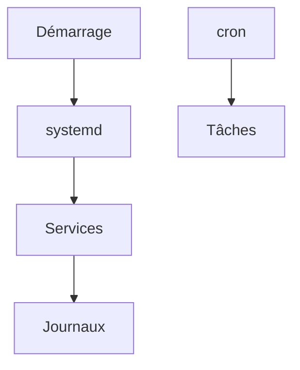

# Cours - Services, journaux et tâches planifiées

> [!abstract] Objectifs
> - Piloter un service avec systemctl
> - Lire les journaux d'un service ou du système
> - Planifier une tâche avec cron

**Prérequis :** [[Cours - Se repérer dans un système Linux]] · [[Processus]]

## 1. Ce qui tourne en fond
Un serveur fait tourner des [[Service (systemd)|services]] : Docker, base de données, serveur web. systemd les démarre, les relance s'ils plantent, et garde leurs journaux.

## 2. Schéma

## 3. Piloter
`systemctl status | start | stop | restart | enable nom`.

## 4. Lire les journaux
[[Journaux système]] : `journalctl -u nom`, `-f` pour suivre, `--since`. Pour un conteneur : `docker logs`. Toujours partir de la **première** erreur.

## 5. Planifier
[[Tâche planifiée (cron)]] : `crontab -e`, 5 champs de date, chemins absolus, sortie redirigée vers un fichier.

## 6. Dépanner un service
1. `systemctl status nom` : actif ? code de sortie ?
2. `journalctl -u nom -n 50` : la première erreur
3. La configuration dans `/etc/...` : modifiée récemment ?
4. Le port : `ss -tlnp`

## Mise en pratique
- Fais l'[[Exercice - Faire tourner et surveiller un service]].

> [!warning] Erreurs fréquentes
> - Faire `start` sans `enable` : le service ne revient pas après redémarrage
> - Une tâche cron qui « ne marche pas » parce qu'elle n'a pas le même PATH que ton terminal
> - Chercher systemd dans un conteneur Docker

## Résumé
En 3 phrases, avec mes mots.

## Concepts du cours
[[Service (systemd)]] · [[Journaux système]] · [[Tâche planifiée (cron)]]
