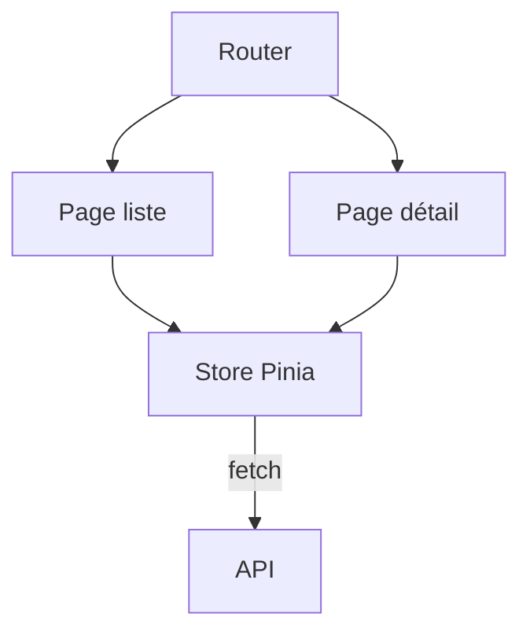

# Cours - Une application Vue, routeur et store

> [!abstract] Objectifs
> - Organiser plusieurs pages avec Vue Router
> - Partager l'état avec Pinia
> - Brancher l'application sur une API

**Prérequis :** [[Cours - Vue.js, composants, réactivité et directives]]

## 1. Plusieurs pages
[[Vue Router]] : routes, `RouterLink`, `RouterView`, paramètres, gardes.

## 2. Schéma

## 3. L'état partagé
[[Pinia]] : state, getters, actions. Les appels d'API vivent dans les actions.

## 4. En production
Comme React : `npm run build`, `dist/` servi par Nginx avec repli vers `index.html`.

## Mise en pratique
- Fais l'[[Exercice - Construire une application Vue avec routeur et store]].

> [!warning] Erreurs fréquentes
> - Croire qu'une garde de route protège les données
> - Mettre tout l'état dans le store

## Résumé
En 3 phrases, avec mes mots.

## Concepts du cours
[[Vue Router]] · [[Pinia]]
