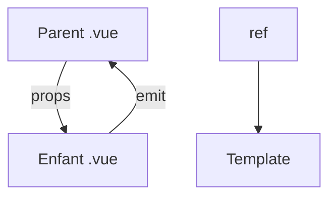

# Cours - Vue.js, composants, réactivité et directives

> [!abstract] Objectifs
> - Créer un projet Vue 3 et écrire des composants .vue
> - Utiliser ref, computed, watch
> - Écrire des templates avec les directives

**Prérequis :** [[Cours - JavaScript dans la page, DOM et événements]] · [[Cours - Penser en composants]]

## 1. Vue en deux mots
[[Vue.js]] : des composants, un template HTML, une réactivité automatique. Si tu as fait React, compare à chaque étape.

| React | Vue |
| --- | --- |
| JSX | template avec directives |
| `useState` + `setX` | `ref` modifiée directement |
| valeur calculée au rendu | `computed` |
| `useEffect` | `onMounted`, `watch` |
| props + fonctions | props + `emit` |

## 2. Schéma

## 3. Le fichier .vue
[[Composant monofichier Vue (SFC)]] : `<script setup>`, `<template>`, `<style scoped>`.

## 4. La réactivité
[[Réactivité Vue (ref et computed)]] : `.value` dans le script, pas dans le template.

## 5. Les directives
[[Directives Vue]] : `v-if`, `v-for` avec `:key`, `v-model`, `:attr`, `@événement`.

## Mise en pratique
- Fais l'[[Exercice - Écrire une liste de tâches en Vue]].

> [!warning] Erreurs fréquentes
> - Oublier `.value`
> - `v-if` et `v-for` sur le même élément
> - Suivre un tutoriel Vue 2 sans le savoir

## Résumé
En 3 phrases, avec mes mots.

## Concepts du cours
[[Vue.js]] · [[Composant monofichier Vue (SFC)]] · [[Réactivité Vue (ref et computed)]] · [[Directives Vue]]
