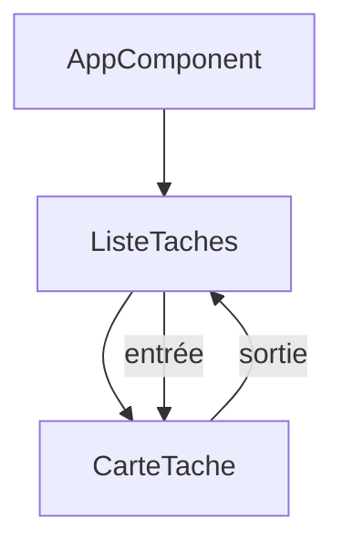

# Cours - Angular, composants et templates

> [!abstract] Objectifs
> - Créer un projet Angular avec le CLI
> - Écrire des composants avec entrées et sorties
> - Utiliser toutes les liaisons du template

**Prérequis :** [[Cours - TypeScript, du JavaScript typé]] · [[Cours - Penser en composants]]

## 1. Un framework complet
[[Angular]] fournit tout, en TypeScript. Plus de règles qu'avec React ou Vue, mais chaque projet se ressemble.

## 2. L'outil
[[Angular CLI]] : `ng new`, `ng serve`, `ng g c`, `ng build`.

## 3. Schéma

## 4. Les composants
[[Composant d'interface]] : classe + template + style ; `input()` et `output()`.

## 5. Le template
[[Template et liaison de données]] : `{{ }}`, `[ ]`, `( )`, `[( )]`, `@if`, `@for`, les pipes.

| React | Vue | Angular |
| --- | --- | --- |
| props | props | `input()` |
| fonction passée en prop | `emit` | `output()` |
| `{x && …}` | `v-if` | `@if` |
| `map` | `v-for` | `@for … track` |

## Mise en pratique
- Pour chaque notion du cours : les **exercices visuels** de sa fiche (section 3), puis le fil rouge de son niveau ([[Niveaux]]).

> [!warning] Erreurs fréquentes
> - Suivre un tutoriel AngularJS
> - Oublier d'importer un composant ou `FormsModule`
> - Oublier `track` dans `@for`

## Résumé
Pas de résumé à écrire : si tu veux, fais un dessin Excalidraw qui relie les notions ci-dessous.

## Concepts du cours
[[Angular]] · [[Angular CLI]] · [[Composant d'interface]] · [[Template et liaison de données]]
