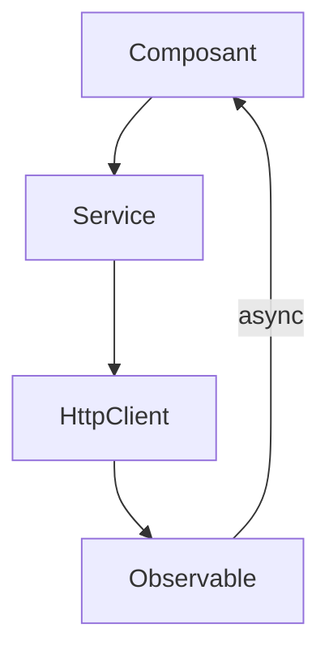

# Cours - Services, RxJS et routeur Angular

> [!abstract] Objectifs
> - Mettre la logique et les appels d'API dans des services injectés
> - Lire et écrire des flux RxJS simples
> - Organiser l'application avec le routeur et des gardes

**Prérequis :** [[Cours - Angular, composants et templates]] · [[Cours - L'asynchrone avec Promesses, async, await et fetch]]

## 1. La logique hors des composants
[[Service et injection de dépendances]] : `@Injectable`, `inject()`, `HttpClient`, intercepteurs.

## 2. Schéma

## 3. Les flux
[[Observable et RxJS]] : rien ne part sans abonnement ; `pipe`, `map`, `catchError`, `switchMap` ; le pipe `async`.

## 4. Les pages
[[Angular Router]] : routes, paramètres, `loadComponent`, `canActivate`.

## 5. En production
`ng build`, puis `dist/` servi par Nginx avec repli vers `index.html`, comme toute SPA.

## Mise en pratique
- Fais l'[[Exercice - Une application Angular avec service, RxJS et routeur]].

> [!warning] Erreurs fréquentes
> - Appeler `http.get` sans s'abonner
> - Fournir un service par composant sans le vouloir
> - S'abonner à la main sans se désabonner

## Résumé
En 3 phrases, avec mes mots.

## Concepts du cours
[[Service et injection de dépendances]] · [[Observable et RxJS]] · [[Angular Router]]
