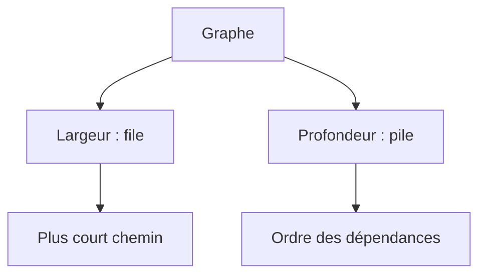

# Cours - Arbres, graphes et parcours

> [!abstract] Objectifs
> - Reconnaître un arbre ou un graphe dans un problème
> - Représenter un graphe en code
> - Parcourir en largeur et en profondeur, trouver un plus court chemin, ordonner des dépendances

**Prérequis :** [[Cours - Récursivité et structures de données]]

## 1. Des relations partout
[[Arbre et graphe]] : dossiers, DOM, commits Git, prérequis des modules, jobs de CI.

## 2. Schéma

## 3. Explorer
[[Parcours en largeur et en profondeur]] : une file ou une pile, et un ensemble `vus`.

## 4. Ce que tu sais maintenant faire
Avec les cours précédents, tu as les briques de presque tous les problèmes classiques : boucles et motifs, recherche, tri, récursivité, pile, file, dictionnaire, graphe. Le reste est surtout de l'entraînement à **reconnaître** quelle brique utiliser.

## Mise en pratique
- Fais l'[[Exercice - Explorer un graphe]].

> [!warning] Erreurs fréquentes
> - Oublier l'ensemble `vus`
> - Pile au lieu de file pour un plus court chemin

## Résumé
En 3 phrases, avec mes mots.

## Concepts du cours
[[Arbre et graphe]] · [[Parcours en largeur et en profondeur]]
