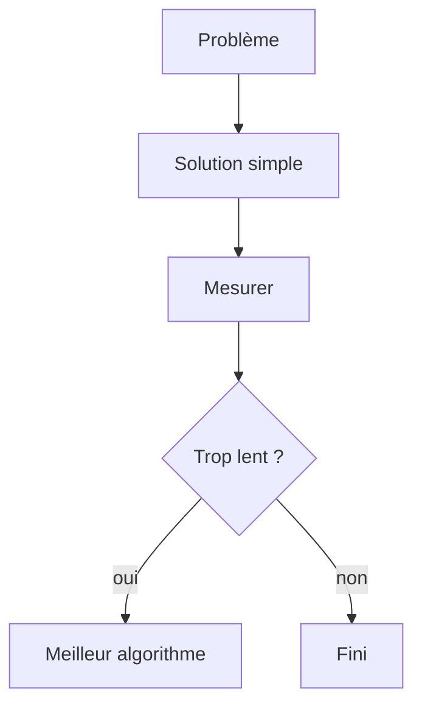

# Cours - Efficacité, recherche et tri

> [!abstract] Objectifs
> - Estimer la complexité d'un algorithme
> - Chercher efficacement
> - Comprendre les grandes idées de tri et trier avec une clé

**Prérequis :** [[Cours - Penser comme un algorithme]]

## 1. Juste, puis rapide
Une solution doit d'abord être **juste**. Ensuite on se demande : tiendra-t-elle avec 1 million d'éléments ? C'est la [[Complexité (notation grand O)]].

## 2. Schéma

## 3. Chercher
[[Recherche linéaire et dichotomique]] : un par un, ou en coupant en deux si c'est trié.

## 4. Trier
[[Algorithmes de tri]] : insertion pour comprendre, fusion pour « diviser pour régner », et `sorted(key=…)` au quotidien.

## 5. Le lien avec le reste
Un index SQL, `git bisect`, un `set` Python : ce sont ces idées, déjà écrites pour toi. Savoir pourquoi ils sont rapides t'aide à les utiliser au bon moment.

## Mise en pratique
- Fais l'[[Exercice - Mesurer, chercher et trier]].

> [!warning] Erreurs fréquentes
> - `x in liste` dans une boucle (O(n²) caché)
> - Dichotomie sur des données non triées
> - Optimiser sans avoir mesuré

## Résumé
En 3 phrases, avec mes mots.

## Concepts du cours
[[Complexité (notation grand O)]] · [[Recherche linéaire et dichotomique]] · [[Algorithmes de tri]]
