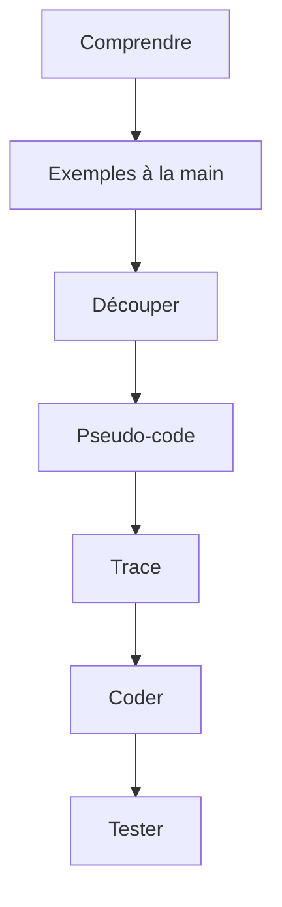

# Cours - Penser comme un algorithme

> [!abstract] Objectifs
> - Comprendre ce qu'est un algorithme, indépendamment du langage
> - Appliquer une méthode pour résoudre n'importe quel problème
> - Écrire du pseudo-code et le dérouler à la main
> - Reconnaître et écrire les motifs de boucle courants

**Prérequis :** [[Cours - Python, premiers pas]]

## 1. La syntaxe ne suffit pas
Connaître `for`, `if` et `def` ne dit pas **quoi** écrire. Ce qui fait un bon développeur, c'est la capacité à trouver une méthode pour un problème qu'il n'a jamais vu : un [[Algorithme]].

## 2. Schéma de la méthode

## 3. Une méthode pour chaque problème
[[Décomposer un problème]] : entrées, sortie, exemples, cas limites, sous-problèmes. C'est la même méthode pour un exercice, un bug ou une fonctionnalité du projet CVAT.

## 4. Réfléchir sans la syntaxe
[[Pseudo-code et trace d'exécution]] : écrire la logique en français, puis la faire tourner à la main avec un tableau des variables. Le débogueur fait la même chose pour toi.

## 5. Les boucles types
[[Motifs de boucle]] : compter, accumuler, chercher, meilleur, filtrer, transformer, regrouper, deux indices. Toujours : valeur de départ, mise à jour, condition d'arrêt.

## 6. S'entraîner
La logique se muscle par la pratique régulière : un petit problème par jour vaut mieux qu'une longue séance par mois. Les sites d'exercices (France-IOI, Exercism, Advent of Code) proposent des problèmes progressifs, en français pour France-IOI.

## Mise en pratique
- Fais l'[[Exercice - Résoudre des problèmes pas à pas]].

> [!warning] Erreurs fréquentes
> - Coder avant d'avoir compris
> - Oublier les cas limites (vide, un seul élément, négatifs)
> - Chercher la solution parfaite au lieu d'une solution simple et juste

## Résumé
En 3 phrases, avec mes mots.

## Concepts du cours
[[Algorithme]] · [[Décomposer un problème]] · [[Pseudo-code et trace d'exécution]] · [[Motifs de boucle]]
