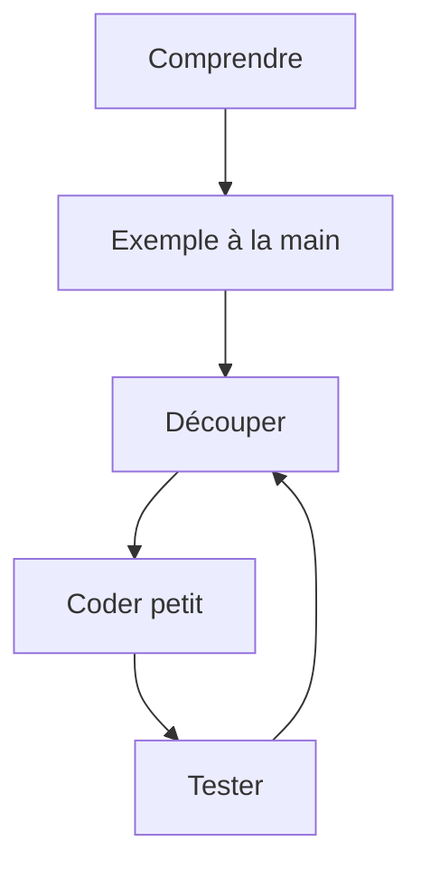
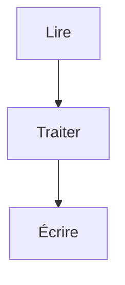
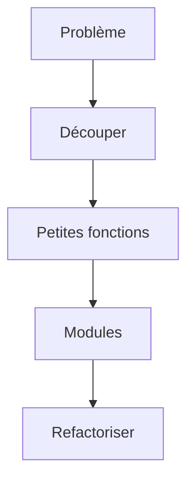

# Cours - Programmer dans n'importe quel langage

> [!abstract] Objectifs
> - Connaître les quelques briques qui existent dans **tous** les langages
> - Savoir se lancer dans un langage inconnu en une heure
> - Découper un problème avant d'écrire du code
> - Écrire du code qu'on peut relire et modifier dans six mois
> - Connaître les trois ou quatre patterns qui servent vraiment, et quand ne pas en mettre

**Prérequis :** aucun. Ce cours est la carte : les détails sont dans les fiches liées.

## 1. Un langage, c'est toujours les mêmes briques
Python, JavaScript, Bash, Java ou Go : la syntaxe change, les idées non. Huit briques suffisent pour écrire presque tout.

| Brique | L'idée | Fiche |
| --- | --- | --- |
| Valeur et variable | Donner un nom à une donnée, qui a un type (nombre, texte, booléen) | [[Variables et types]] |
| Condition | Faire une chose ou une autre selon un test | [[Condition (if)]] |
| Boucle | Répéter pour chaque élément, ou tant qu'une condition est vraie | [[Boucle (for, while)]] |
| Collection | Ranger plusieurs valeurs : une liste (dans l'ordre) ou un dictionnaire (par clé) | [[Liste et dictionnaire]] |
| Fonction | Donner un nom à une suite d'étapes, avec des entrées et une sortie | [[Fonction]] |
| Module | Ranger les fonctions dans des fichiers et les importer | [[Module et import]] |
| Erreur | Signaler qu'on ne peut pas continuer, et le rattraper là où on sait quoi faire | [[Exception]] |
| Objet | Regrouper des données et les fonctions qui vont avec | [[Classe et objet]] |

> [!abstract]- Comment ça s'écrit (référence à chercher, pas à apprendre par cœur)
> | Brique | Python | JavaScript | Bash |
> | --- | --- | --- | --- |
> | Variable | `total = 0` | `let total = 0` | `total=0` |
> | Condition | `if x > 10:` | `if (x > 10) {` | `if [ "$x" -gt 10 ]; then` |
> | Boucle | `for d in depenses:` | `for (const d of depenses) {` | `for f in *.csv; do` |
> | Liste | `[1, 2]` | `[1, 2]` | `(1 2)` |
> | Dictionnaire | `{"loyer": 800}` | `{ loyer: 800 }` | `declare -A` (rare) |
> | Fonction | `def total(l):` | `function total(l) {` | `total() {` |
> | Erreur | `raise` / `try` | `throw` / `try` | code de sortie, `set -e` |

## 2. Apprendre un nouveau langage vite
Ne lis pas tout le manuel. Prends la liste des huit briques et cherche comment **chacune** s'écrit dans le nouveau langage. En une heure tu sais lire la plupart du code. Ensuite, il reste trois questions à poser :
1. **Comment on lance un programme** (interprété, compilé, dans un conteneur) ?
2. **Comment on installe une bibliothèque** ([[Gestionnaire de paquets]]) ?
3. **Comment on lit une erreur** (où est la ligne fautive dans le message) ?

Le reste s'apprend en lisant du vrai code et en cherchant au besoin.

## 3. Avant le code : découper le problème
Le piège le plus courant est d'ouvrir l'éditeur trop tôt. Un bon développeur passe d'abord du temps sans code.

1. **Comprendre** : qu'est-ce qui entre, qu'est-ce qui doit sortir ? Écris-le en une phrase.
2. **Faire un exemple à la main** : avec trois lignes de données, quel résultat exact tu attends ?
3. **Découper** : chaque morceau doit tenir en une phrase avec un verbe (« lire le fichier », « classer une dépense », « calculer les totaux »). Si la phrase contient « et », découpe encore. Voir [[Décomposer un problème]].
4. **Coder petit** : un morceau à la fois, qu'on fait marcher avant de passer au suivant.
5. **Tester** : comparer à ton exemple fait à la main.

## 4. Écrire du code maintenable
Du code maintenable, c'est du code qu'une autre personne (ou toi dans six mois) comprend et modifie sans peur. Quelques règles couvrent l'essentiel.

**Bien nommer.** Un nom dit **ce que c'est** ou **ce que ça fait** : `totaux_par_categorie`, pas `calc2` ni `data`. Si tu n'arrives pas à nommer une fonction, c'est qu'elle fait trop de choses.

**Une fonction, un travail.** Elle reçoit ce dont elle a besoin en paramètres et **renvoie** son résultat. Elle ne lit pas une variable globale et n'affiche rien, sauf si c'est son seul rôle.

**Séparer entrée, traitement et sortie.** Lire les données (fichier, API, clavier), les transformer, puis afficher ou écrire : trois parties qui ne se mélangent pas. On peut alors changer le format du fichier sans toucher au calcul, et tester le calcul sans fichier. Voir [[Séparation des responsabilités]].

**Les trois réflexes de bon sens** ([[Principes DRY, KISS et YAGNI]]) :
- **DRY** : une même règle n'est écrite qu'à un seul endroit. Si tu copies-colles un bloc pour la troisième fois, fais-en une fonction.
- **KISS** : la solution la plus simple qui marche. Du code astucieux est du code difficile à relire.
- **YAGNI** : ne code pas ce dont tu n'as pas besoin aujourd'hui « au cas où ».

**Échouer clairement.** Une erreur prévue (fichier absent, valeur invalide) donne un message clair qui dit quoi faire. On ne cache pas une erreur avec un `try` vide.

**Améliorer par petits pas.** Changer la structure sans changer le comportement, un pas à la fois, en vérifiant après chaque pas : c'est la [[Refactorisation]]. Les tests rendent ça sûr.

## 5. Les patterns : peu, et seulement s'ils aident
Un [[Design pattern]] est une solution connue à un problème qui revient souvent. Il en existe des dizaines. Trois idées couvrent la plupart des besoins réels :

| Idée | Le problème | La solution |
| --- | --- | --- |
| [[Patron Stratégie (Strategy)\|Stratégie]] | Plusieurs façons de faire la même chose (exporter en CSV ou en JSON) et une pile de `if` qui grossit | Une fonction (ou un objet) par façon, qu'on passe en paramètre |
| [[Patron Adaptateur (Adapter)\|Adaptateur]] | Un outil extérieur (API, bibliothèque) qui ne parle pas comme ton code | Une petite couche qui traduit, pour que le reste du code ne connaisse pas l'outil |
| [[Patron Façade (Facade)\|Façade]] | Une suite d'appels compliqués qu'on répète partout | Une seule fonction simple qui cache ces appels |

Et une règle générale : **préférer assembler des petits morceaux plutôt qu'hériter** ([[Héritage et composition]]). L'héritage lie fortement les classes. L'assemblage permet de remplacer une pièce sans toucher aux autres.

> [!warning] Quand ne pas mettre de pattern
> Si le code est simple et ne change pas, un pattern ne fait qu'ajouter des fichiers. On l'introduit quand la douleur apparaît (le même `if` à cinq endroits, un outil extérieur qu'on veut pouvoir changer), pas avant. C'est YAGNI.

## 6. Le résumé en une image

## Concepts du cours
[[Décomposer un problème]] · [[Variables et types]] · [[Condition (if)]] · [[Boucle (for, while)]] · [[Liste et dictionnaire]] · [[Fonction]] · [[Module et import]] · [[Exception]] · [[Classe et objet]] · [[Séparation des responsabilités]] · [[Principes DRY, KISS et YAGNI]] · [[Refactorisation]]
