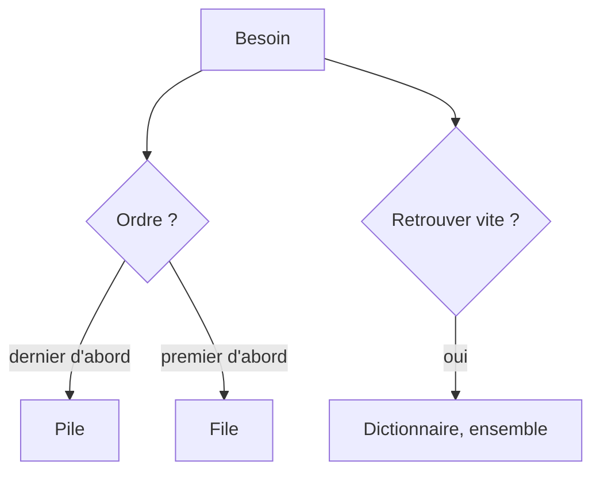

# Cours - Récursivité et structures de données

> [!abstract] Objectifs
> - Écrire une fonction récursive avec un cas de base
> - Utiliser une pile et une file
> - Utiliser les dictionnaires et ensembles pour passer de O(n²) à O(n)

**Prérequis :** [[Cours - Efficacité, recherche et tri]]

## 1. Se ramener à plus petit
[[Récursivité]] : un cas de base, un cas récursif plus petit. Idéal pour les dossiers et les JSON imbriqués.

## 2. Schéma

## 3. L'ordre de traitement
[[Pile et file]] : la pile d'appels, Ctrl+Z, les parenthèses ; les files de tâches.

## 4. Retrouver instantanément
[[Table de hachage]] : `dict`, `set`, `Map`, `Set`. Le réflexe pour compter, regrouper, dédoublonner.

## 5. Choisir sa structure
Bien choisir la structure de données, c'est souvent la moitié de l'algorithme : une liste pour l'ordre, un dictionnaire pour retrouver, un ensemble pour l'unicité, une file pour attendre.

## Mise en pratique
- Fais l'[[Exercice - Récursivité, piles et dictionnaires]].

> [!warning] Erreurs fréquentes
> - Récursion sans cas de base
> - `pop(0)` sur une grande liste
> - Liste comme clé de dictionnaire

## Résumé
En 3 phrases, avec mes mots.

## Concepts du cours
[[Récursivité]] · [[Pile et file]] · [[Table de hachage]]
