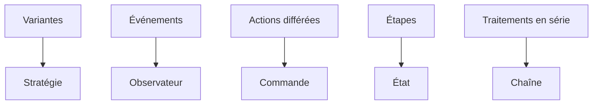

# Cours - Design patterns comportementaux

> [!abstract] Objectifs
> - Remplacer des `if/elif` par des stratégies
> - Découpler avec des événements
> - Transformer des actions en objets (files, annulation)
> - Modéliser des états et transitions
> - Enchaîner des traitements
> - Fixer un déroulé commun

**Prérequis :** [[Cours - Design patterns structurels]]

## 1. Faire collaborer
Les patrons comportementaux organisent **qui fait quoi** et **qui prévient qui**.

## 2. Schéma

## 3. Les variantes
[[Patron Stratégie (Strategy)]] : une fonction ou une classe par variante.

## 4. Prévenir sans connaître
[[Patron Observateur (Observer)]] : `addEventListener`, RxJS, webhooks.

## 5. L'action devient un objet
[[Patron Commande (Command)]] : files de tâches, annuler, rejouer.

## 6. Les étapes
[[Patron État (State)]] : une table des transitions permises.

## 7. En série
[[Patron Chaîne de responsabilité]] : les middlewares.

## 8. Le squelette commun
[[Patron Méthode modèle (Template Method)]] : les cycles de vie des frameworks.

## 9. Ce qu'il faut retenir
Tu n'as pas besoin de connaître les 23 patrons par cœur. Retiens surtout **les problèmes** qu'ils résolvent ; le jour où tu rencontres le problème, tu sauras qu'une solution existe et tu sauras la chercher.

## Mise en pratique
- Fais l'[[Exercice - Patrons comportementaux]], puis l'[[Exercice - Reconnaître le bon patron]].

> [!warning] Erreurs fréquentes
> - Stratégie pour deux cas stables
> - Abonnés jamais désabonnés
> - Middleware qui oublie `next()`

## Résumé
En 3 phrases, avec mes mots.

## Concepts du cours
[[Patron Stratégie (Strategy)]] · [[Patron Observateur (Observer)]] · [[Patron Commande (Command)]] · [[Patron État (State)]] · [[Patron Chaîne de responsabilité]] · [[Patron Méthode modèle (Template Method)]]
