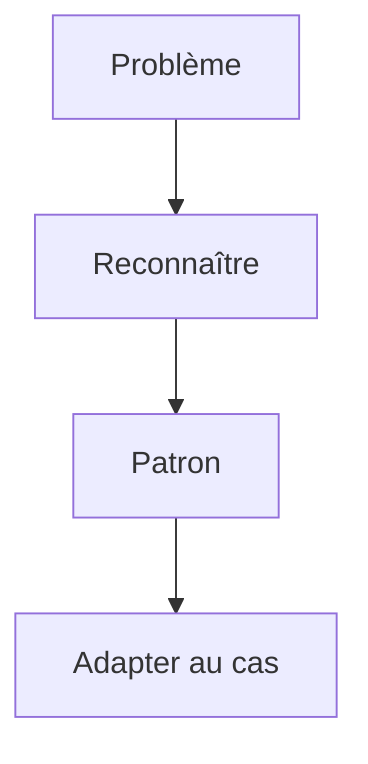

# Cours - Design patterns créationnels

> [!abstract] Objectifs
> - Comprendre ce qu'est un patron et quand en utiliser un
> - Centraliser la création d'objets avec une fabrique
> - Construire des objets complexes lisiblement
> - Savoir pourquoi le singleton est à manier avec prudence

**Prérequis :** [[Cours - Programmation orientée objet, les bases]]

## 1. Un vocabulaire commun
Un [[Design pattern]] est une solution connue à un problème qui revient. Le livre de référence (1994, « Gang of Four ») en décrit 23, rangés en trois familles :
- **créationnels** : comment créer les objets ;
- **structurels** : comment les assembler ;
- **comportementaux** : comment ils collaborent.

## 2. Schéma

## 3. Choisir quoi créer
[[Patron Fabrique (Factory)]] : la décision « quelle classe ? » à un seul endroit.

## 4. Construire pas à pas
[[Patron Monteur (Builder)]] : quand il y a beaucoup d'options et d'étapes.

## 5. Une seule instance
[[Patron Singleton]] : utile pour une configuration ou une connexion, dangereux comme variable globale déguisée.

## 6. La règle d'or
On part du **problème**, jamais du patron. Un patron appliqué sans besoin rend le code plus compliqué.

## Mise en pratique
- Fais l'[[Exercice - Patrons créationnels]].

> [!warning] Erreurs fréquentes
> - Chercher où placer un patron au lieu de partir du problème
> - Un singleton modifiable partout
> - Un monteur pour trois paramètres

## Résumé
En 3 phrases, avec mes mots.

## Concepts du cours
[[Design pattern]] · [[Patron Fabrique (Factory)]] · [[Patron Monteur (Builder)]] · [[Patron Singleton]]
