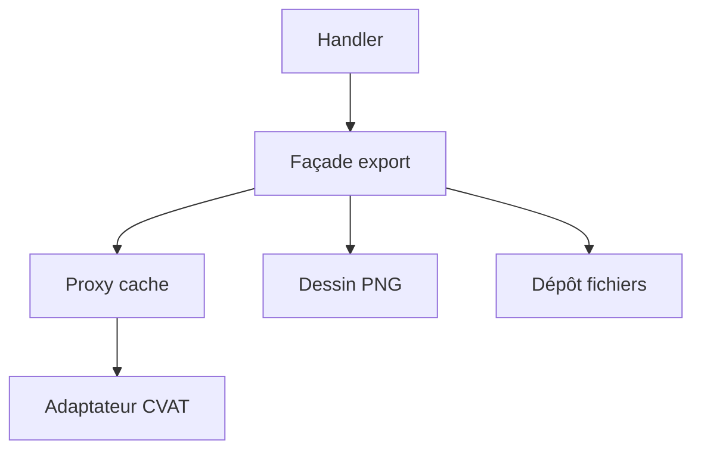

# Cours - Design patterns structurels

> [!abstract] Objectifs
> - Isoler son code des bibliothèques avec un adaptateur
> - Ajouter des comportements sans modifier le code avec un décorateur
> - Simplifier un ensemble compliqué avec une façade
> - Contrôler l'accès avec un proxy
> - Séparer l'accès aux données avec un dépôt

**Prérequis :** [[Cours - Design patterns créationnels]]

## 1. Assembler sans tout mélanger
Les patrons structurels disent comment brancher des objets entre eux en gardant chacun simple et remplaçable.

## 2. Schéma de ta fonction Nuclio

## 3. Traduire
[[Patron Adaptateur (Adapter)]] : ton interface devant le SDK de CVAT.

## 4. Envelopper
[[Patron Décorateur (Decorator)]] : nouveaux essais, mesure, cache, avec `@`.

## 5. Simplifier
[[Patron Façade (Facade)]] : une méthode `exporter(tache_id)` qui orchestre tout.

## 6. Contrôler l'accès
[[Patron Proxy]] : cache, chargement différé, droits.

## 7. Les données
[[Patron Dépôt (Repository)]] : le code métier ne connaît pas la base.

## 8. Comment les distinguer
| Patron | Interface | Intention |
| --- | --- | --- |
| Adaptateur | change | traduire |
| Décorateur | identique | ajouter un comportement |
| Proxy | identique | contrôler l'accès |
| Façade | nouvelle, plus simple | cacher la complexité |

## Mise en pratique
- Fais l'[[Exercice - Patrons structurels pour la fonction d'export]].

> [!warning] Erreurs fréquentes
> - Façade qui devient un objet qui fait tout
> - Décorateurs empilés sans `functools.wraps`
> - Dépôt qui renvoie des objets de l'ORM

## Résumé
En 3 phrases, avec mes mots.

## Concepts du cours
[[Patron Adaptateur (Adapter)]] · [[Patron Décorateur (Decorator)]] · [[Patron Façade (Facade)]] · [[Patron Proxy]] · [[Patron Dépôt (Repository)]]
