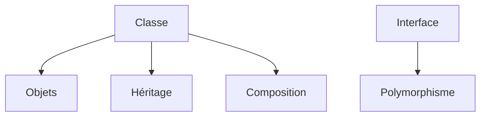

# Cours - Programmation orientée objet, les bases

> [!abstract] Objectifs
> - Écrire des classes avec attributs, méthodes et règles
> - Choisir entre héritage et composition
> - Utiliser des interfaces pour rendre le code interchangeable

**Prérequis :** [[Cours - Fonctions, modules et erreurs]]

## 1. Pourquoi des objets
Jusqu'ici : des données (dictionnaires) et des fonctions séparées. Une [[Classe et objet|classe]] réunit les deux et protège ses règles.

## 2. Schéma

## 3. Relier les classes
[[Héritage et composition]] : « est un » ou « a un ». Préfère la composition.

## 4. Le contrat
[[Interface et polymorphisme]] : décrire **ce que** sait faire un objet, et écrire du code qui marche avec tous ceux qui respectent le contrat. C'est la clé de tous les patrons qui suivent.

## 5. Dans les autres langages
TypeScript : `class`, `implements`, `private`. Angular est entièrement écrit en classes. En JavaScript courant et en React, on utilise surtout des fonctions et des objets simples, mais les mêmes idées s'appliquent.

## Mise en pratique
- Fais l'[[Exercice - Modéliser avec des classes]].

> [!warning] Erreurs fréquentes
> - Des classes pour tout, même pour un petit script
> - Héritage pour simplement réutiliser du code
> - Accéder partout aux attributs internes (`_x`)

## Résumé
En 3 phrases, avec mes mots.

## Concepts du cours
[[Classe et objet]] · [[Héritage et composition]] · [[Interface et polymorphisme]]
