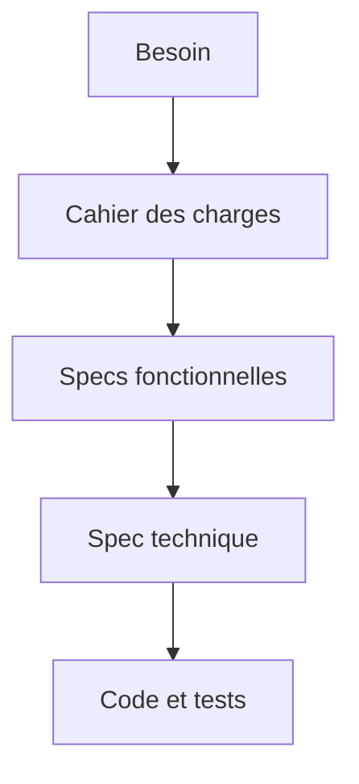
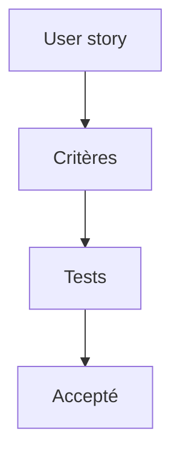

# Cours - Lire et écrire des specs

> [!abstract] Objectifs
> - Savoir ce qu'on entend par « les specs » et ce qu'elles contiennent
> - Écrire des exigences vérifiables, des user stories et des critères d'acceptation
> - Distinguer specs fonctionnelles, spec technique, cahier des charges et ADR

**Prérequis :** [[Cours - POC, prototype et MVP]]

## 1. Pourquoi écrire avant de coder
Quand quelqu'un dit « il faudrait un bouton pour exporter en PNG », chacun imagine une chose différente : où est le bouton, une image par photo ou une seule planche, qui a le droit, combien de temps ça peut prendre… La [[Spécification (specs)|spécification]] met tout le monde d'accord **par écrit**, quand changer d'avis ne coûte encore rien.

## 2. Du besoin au code

- Le [[Cahier des charges]] : le besoin, écrit par le demandeur.
- Les specs fonctionnelles : le **quoi**, vu par l'utilisateur.
- La [[Spécification technique]] : le **comment**, vu par les développeurs.
- Les [[Décision d'architecture (ADR)|ADR]] : la trace des choix importants, un par fichier.

Dans une petite équipe, tout cela tient parfois en une seule page. Ce qui compte, c'est que chaque partie existe.

## 3. Les exigences
[[Exigences fonctionnelles et non fonctionnelles]] : ce que le logiciel fait, et comment il doit le faire (vitesse, sécurité, déploiement). La règle d'or : **une exigence doit être vérifiable**. « Rapide » ne l'est pas ; « moins de 10 s pour 50 images » l'est.

## 4. User stories et critères d'acceptation
Dans les équipes agiles, les specs fonctionnelles prennent la forme de [[User story|user stories]] : *En tant que… je veux… afin de…*. Chacune porte ses [[Critères d'acceptation|critères d'acceptation]] : *Étant donné… quand… alors…*. Ces critères deviennent ensuite des tests.

## 5. Le plan d'une spec courte
1. Contexte et objectif
2. Périmètre : dedans **et hors périmètre**
3. Exigences numérotées (F1, NF1…)
4. User stories et critères d'acceptation
5. Contraintes (infrastructure, sécurité, délais)
6. Questions ouvertes

Le modèle complet et les règles sont dans [[Bonnes pratiques - Specs]].

## 6. Lire des specs qu'on te donne
Lire une spec, c'est surtout **chercher ce qui manque** : un cas d'erreur non décrit, un mot flou (« rapide », « simple », « etc. »), une exigence impossible à tester, une contradiction. Chaque trou devient une question à poser **avant** de coder.

## Mise en pratique
- Fais l'[[Exercice - Écrire les specs du bouton d'export]].
- Puis l'[[Exercice - Critiquer un cahier des charges]].

> [!warning] Erreurs fréquentes
> - Décrire la solution (« utiliser Redis ») au lieu du besoin (« répondre en moins de 1 s »)
> - Oublier les exigences non fonctionnelles et les cas d'erreur
> - Des mots flous impossibles à tester
> - Oublier le « hors périmètre », et voir le projet grossir sans fin
> - Ne pas mettre à jour la spec quand la décision change

## Résumé
En 3 phrases, avec mes mots.

## Concepts du cours
[[Spécification (specs)]] · [[Exigences fonctionnelles et non fonctionnelles]] · [[Cahier des charges]] · [[User story]] · [[Critères d'acceptation]] · [[Spécification technique]] · [[Décision d'architecture (ADR)]]
