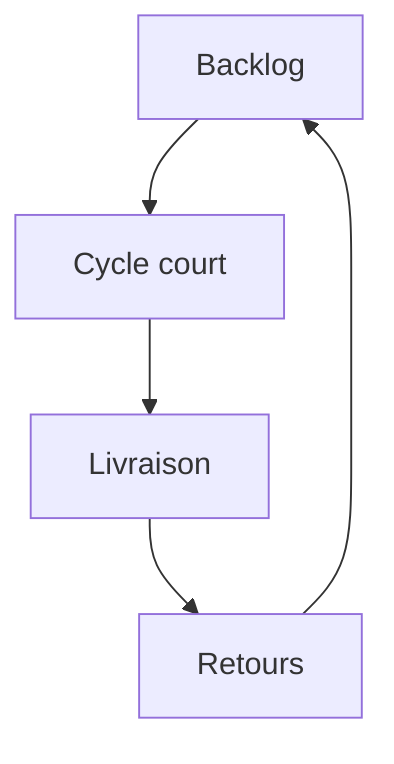

# Cours - Organiser le travail en agile

> [!abstract] Objectifs
> - Comprendre l'idée des méthodes agiles et le vocabulaire de Scrum et Kanban
> - Tenir un backlog et le prioriser
> - Savoir quand un travail est vraiment terminé

**Prérequis :** [[Cours - Lire et écrire des specs]]

## 1. Pourquoi de petits cycles
Dans un projet « en cascade », on spécifie tout, puis on code tout, puis on teste tout : les malentendus apparaissent à la fin, au pire moment. Les [[Méthode agile (Scrum et Kanban)|méthodes agiles]] coupent le projet en petits cycles qui livrent chacun quelque chose qui marche.

## 2. Le backlog
Le [[Backlog et priorisation|backlog]] contient tout ce qui reste à faire, **dans l'ordre**. En haut : des [[User story|user stories]] petites et prêtes ; en bas : des idées floues. On le trie avec MoSCoW (Must, Should, Could, Won't) et on traite **les risques d'abord** : c'est exactement pour ça qu'on fait un POC en premier.

## 3. Scrum ou Kanban
- **Scrum** : sprints de 2 semaines, planification, point quotidien, démonstration, rétrospective.
- **Kanban** : un tableau À faire, En cours, En revue, Terminé, avec une limite de cartes « En cours ».

Seul ou à deux sur un projet comme le tien, un tableau Kanban dans GitLab (*Issue boards*) suffit largement.

## 4. Quand est-ce fini ?
Deux listes complémentaires :
- les [[Critères d'acceptation|critères d'acceptation]], propres à chaque story ;
- la [[Définition de terminé]], commune à toutes : relu, pipeline verte, documentation à jour, déployé en recette.

## 5. Le lien avec ce que tu sais déjà
Une story = un ticket GitLab = une branche = une [[Merge request]]. La pipeline de CI vérifie une partie de la définition de terminé à ta place.

## Mise en pratique
- Fais l'[[Exercice - Organiser son projet en backlog]].
- Puis, à la fin de ton POC, l'[[Exercice - Conclure un POC]].

> [!warning] Erreurs fréquentes
> - Tout mettre en « Must »
> - Commencer dix tâches et n'en finir aucune
> - Déclarer « fini » ce qui marche seulement sur sa machine
> - Croire qu'agile veut dire sans plan ni documentation

## Résumé
En 3 phrases, avec mes mots.

## Concepts du cours
[[Méthode agile (Scrum et Kanban)]] · [[Backlog et priorisation]] · [[Définition de terminé]]
