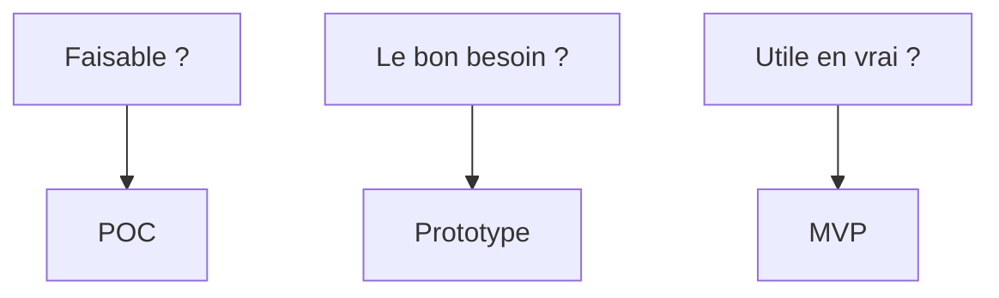

# Cours - POC, prototype et MVP

> [!abstract] Objectifs
> - Comprendre ce qu'est un POC et à quoi il sert vraiment
> - Ne plus confondre POC, prototype et MVP
> - Savoir cadrer un POC avant de coder, et le conclure à la fin

**Prérequis :** aucun

## 1. Le problème de départ
Avant de lancer un vrai développement, une équipe a des **doutes** : est-ce que c'est faisable ? est-ce que c'est ce que veulent les utilisateurs ? est-ce que quelqu'un s'en servira ? Chaque doute est un **risque**. Les trois mots de ce cours sont trois façons de lever un risque en dépensant le moins possible.

## 2. Trois questions, trois outils

| | [[Preuve de concept (POC)\|POC]] | [[Prototype]] | [[MVP (produit minimum viable)\|MVP]] |
|---|---|---|---|
| Question | Est-ce faisable techniquement ? | Est-ce ce qu'il faut ? | Est-ce utile pour de vrai ? |
| Pour qui | L'équipe, le responsable | Les utilisateurs, le client | De vrais utilisateurs |
| Livrable | Une **réponse** et un compte rendu | Une maquette ou une démo | Un produit en production |
| Qualité du code | Jetable | Souvent pas de code du tout | Production : tests, sécurité |
| Durée | Quelques jours à 3 semaines | Quelques jours | Quelques semaines à mois |

## 3. Ton projet actuel est un POC
Ton projet CVAT et Nuclio répond à une question : *peut-on, dans l'infrastructure de l'entreprise (GitLab, Nexus), ajouter un bouton à CVAT qui appelle une fonction Nuclio et renvoie un PNG des annotations ?*

Un POC bien mené suit quatre temps :
1. **Cadrer** : la question, les hypothèses, les critères de succès, la durée, ce qui est hors périmètre. *Avant* de coder.
2. **Essayer** : le chemin le plus court vers la réponse. Les raccourcis sont permis.
3. **Mesurer** : chaque critère de succès est-il atteint ? Qu'a-t-on découvert (limites, surprises) ?
4. **Conclure** : un compte rendu court et une recommandation (continuer, changer d'approche, abandonner).

Un POC qui répond « non » est **réussi** : il a évité de perdre des mois.

## 4. Les raccourcis ont un prix
Dans un POC, on code vite exprès : jeton en dur, pas de gestion d'erreur, pas de tests. C'est de la [[Dette technique]] **volontaire**. Elle devient un problème quand on oublie qu'elle existe et qu'on met ce code en production tel quel. Règle : noter chaque raccourci (`# DETTE :`) et le lister dans le compte rendu.

## 5. Et après le POC ?
Si la réponse est oui, on écrit les [[Spécification (specs)|specs]] du vrai produit (cours suivant), on prépare le [[MVP (produit minimum viable)|MVP]], et on réécrit proprement ce qui doit l'être.

## Mise en pratique
- Fais l'[[Exercice - POC, prototype ou MVP]].
- Puis l'[[Exercice - Cadrer son POC CVAT]] : c'est ton vrai projet.

> [!warning] Erreurs fréquentes
> - Commencer à coder sans avoir écrit la question ni les critères de succès
> - Un POC sans date de fin, qui devient un projet à moitié fini
> - Peaufiner l'interface ou le code d'un POC alors que la question est technique
> - Mettre le code du POC en production sans le reprendre
> - Appeler « MVP » une démo qui ne tient pas en production

## Résumé
En 3 phrases, avec mes mots.

## Concepts du cours
[[Preuve de concept (POC)]] · [[Prototype]] · [[MVP (produit minimum viable)]] · [[Dette technique]]
