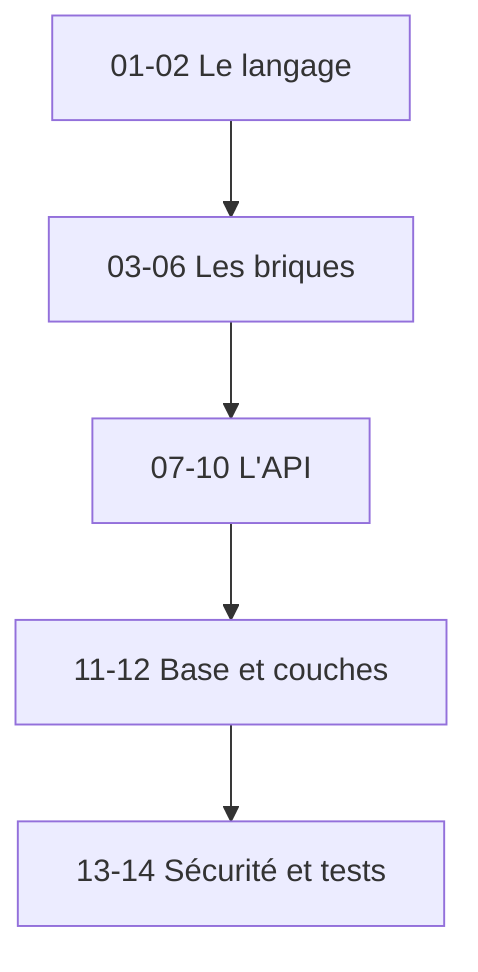

# .NET - le plan

> [!info] À quoi sert ce cours
> Comprendre **n'importe quel backend .NET** : lire son code, le lancer, y ajouter une route. Chaque chapitre est court : à quoi ça sert, des exemples de code commentés, ce qu'il faut retenir, un piège. Les exemples suivent la même petite API de produits, du premier au dernier chapitre.

| # | Chapitre | À quoi ça sert |
|---|---|---|
| 1 | [[Cours - .NET 01 - Le SDK, les projets et la solution|Le SDK, les projets et la solution]] | ouvrir un projet, le compiler, le lancer |
| 2 | [[Cours - .NET 02 - Les bases du CSharp|Les bases du C#]] | variables, null, textes, switch, méthodes |
| 3 | [[Cours - .NET 03 - Classes, propriétés, record et interface|Classes, propriétés, record et interface]] | les 3 sortes de classes d'un backend |
| 4 | [[Cours - .NET 04 - Listes et LINQ|Listes et LINQ]] | filtrer, trier, transformer des listes |
| 5 | [[Cours - .NET 05 - async, await et Task|async, await et Task]] | attendre la base sans bloquer |
| 6 | [[Cours - .NET 06 - Exceptions et logs|Exceptions et logs]] | gérer les erreurs, écrire des logs |
| 7 | [[Cours - .NET 07 - L'injection de dépendances|L'injection de dépendances]] | comment controller, service et repository se reçoivent |
| 8 | [[Cours - .NET 08 - Program.cs et la configuration|Program.cs et la configuration]] | le tableau de bord de l'API, et ses réglages |
| 9 | [[Cours - .NET 09 - Controllers, routes et attributs|Controllers, routes et attributs]] | la porte d'entrée HTTP et les [ ] |
| 10 | [[Cours - .NET 10 - DTO et validation|DTO et validation]] | ce qui entre et sort de l'API |
| 11 | [[Cours - .NET 11 - EF Core, la base de données|EF Core, la base de données]] | classes ↔ tables, requêtes, migrations |
| 12 | [[Cours - .NET 12 - Les couches, controller, service, repository|Les couches, controller, service, repository]] | ranger le code : un exemple complet |
| 13 | [[Cours - .NET 13 - Authentification et Authorize|Authentification et Authorize]] | qui appelle, et a-t-il le droit |
| 14 | [[Cours - .NET 14 - Tester avec xUnit|Tester avec xUnit]] | vérifier une règle automatiquement |

**À côté :** [[Fiche - Syntaxe CSharp en un coup d'œil]] · [[Bonnes pratiques - .NET]]
