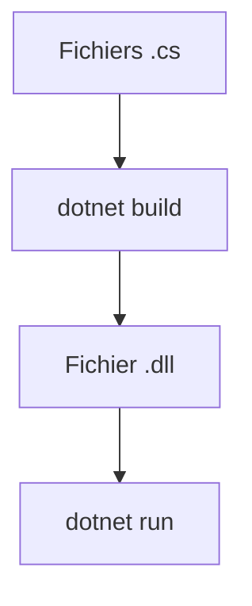

# 01 · Le SDK, les projets et la solution

> [!info] À quoi ça sert
> Savoir ce que contient un dossier .NET et le faire tourner : c'est la première chose à faire sur n'importe quel projet.

## 1. Ce qui se passe quand on lance



Le **SDK** compile le C# en `.dll`, le **runtime** l'exécute. Une seule commande pilote tout : `dotnet`.

## 2. Les fichiers qu'on trouve

```text
MonApp/
├── MonApp.sln                 ← la solution : regroupe les projets
├── global.json                ← la version du SDK imposée
├── MonApp.Api/
│   ├── MonApp.Api.csproj      ← la carte d'identité du projet
│   ├── Program.cs             ← le point de départ
│   ├── appsettings.json       ← la configuration
│   └── Properties/launchSettings.json  ← les ports
└── MonApp.Tests/
    └── MonApp.Tests.csproj
```

Le `.csproj` dit la version de .NET et les paquets utilisés :

```xml
<Project Sdk="Microsoft.NET.Sdk.Web">
  <PropertyGroup>
    <TargetFramework>net8.0</TargetFramework>   <!-- version de .NET -->
    <Nullable>enable</Nullable>                 <!-- le compilateur surveille les null -->
  </PropertyGroup>
  <ItemGroup>
    <PackageReference Include="Microsoft.EntityFrameworkCore" Version="8.0.0" />
    <ProjectReference Include="..\MonApp.Core\MonApp.Core.csproj" />  <!-- un autre projet -->
  </ItemGroup>
</Project>
```

`global.json` fixe la version du SDK pour tout le monde :

```json
{ "sdk": { "version": "8.0.400", "rollForward": "latestFeature" } }
```

## 3. Les commandes

| Je veux… | Commande |
|---|---|
| voir les SDK installés | `dotnet --list-sdks` |
| télécharger les paquets | `dotnet restore` |
| compiler | `dotnet build` |
| lancer | `dotnet run --project MonApp.Api` |
| relancer à chaque modif | `dotnet watch run --project MonApp.Api` |
| ajouter un paquet | `dotnet add package NomDuPaquet` |
| lancer les tests | `dotnet test` |

## À retenir
- `.sln` = plusieurs projets, `.csproj` = un projet.
- Le code démarre dans `Program.cs`.
- `bin/` et `obj/` sont produits par la compilation : jamais dans Git.

> [!warning] Piège
> Ne pas modifier `global.json` du dépôt pour que ça marche chez soi : installer la version demandée.

## Concepts
[[Plateforme .NET]] · [[SDK]] · [[Projet et solution .NET]] · [[Gestionnaire de paquets]]

---
[[Cours - .NET - le plan|Le plan]] · [[Cours - .NET 02 - Les bases du CSharp|Les bases du C#]] →
