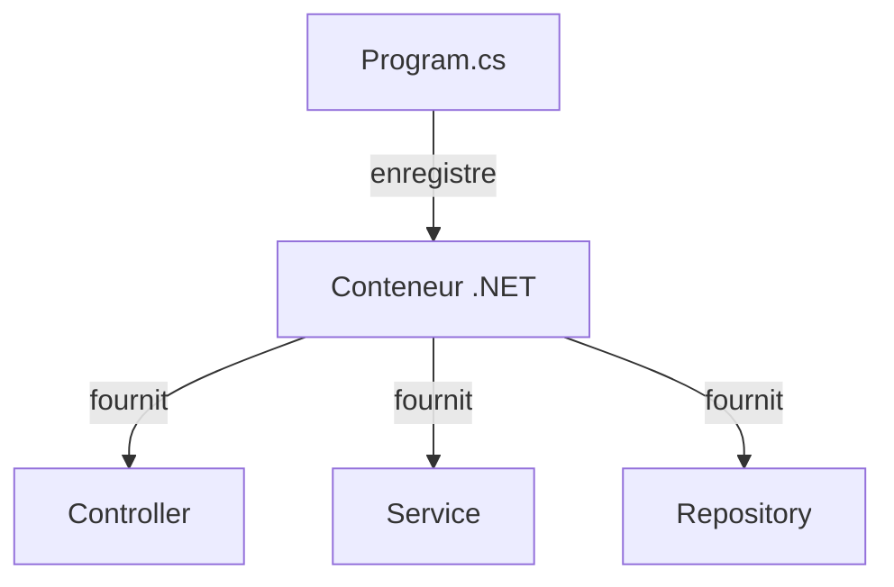
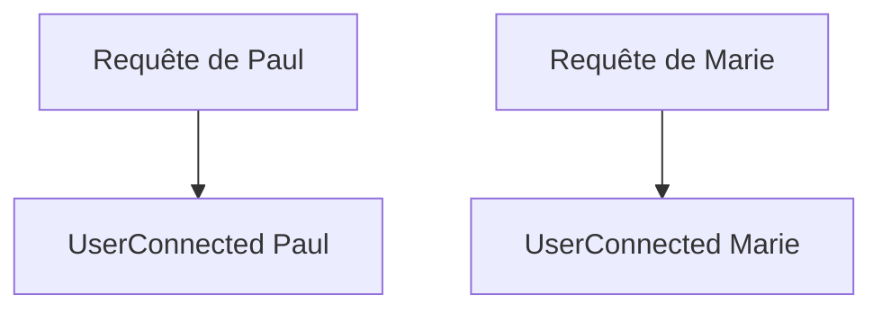

# 07 · L'injection de dépendances

> [!info] À quoi ça sert
> Une classe ne crée pas elle-même ce dont elle a besoin : elle le **demande dans son constructeur**, et .NET le lui fournit. C'est ce qui relie controller, service et repository.

## 1. Sans injection

```csharp
public class ProductService
{
    private readonly ProductRepository _repo = new ProductRepository();   // ❌ figé
}
```

Impossible de remplacer `ProductRepository` (par un faux en test, par une autre base).

## 2. Avec injection

```csharp
public class ProductService : IProductService
{
    private readonly IProductRepository _repository;

    public ProductService(IProductRepository repository)   // ✅ je demande
    {
        _repository = repository;
    }
}
```

Et dans `Program.cs`, on dit **quelle classe** donner pour **quelle interface** :

```csharp
builder.Services.AddScoped<IProductRepository, ProductRepository>();
builder.Services.AddScoped<IProductService, ProductService>();
```



## 3. Combien de temps vit l'objet

| Méthode | Un objet… | Pour |
|---|---|---|
| `AddScoped` | **par requête** | services, repositories, `DbContext` |
| `AddSingleton` | pour **toute l'appli** | cache, configuration |
| `AddTransient` | à **chaque** demande | petits outils sans état |

## 4. Le constructeur raccourci (C# 12)

```csharp
public class ProductService(IProductRepository repository) : IProductService
{
    public Task<Product?> Get(int id) => repository.GetByIdAsync(id);
}
```

Même chose, écrit plus court : tu le verras dans les projets récents.

## 5. Comment .NET trouve le bon objet

Au démarrage, `Program.cs` remplit une sorte de **dictionnaire** : « type demandé → classe à créer ».

| Demandé (clé) | Créé (valeur) |
|---|---|
| `IProductService` | `ProductService` |
| `IProductRepository` | `ProductRepository` |

Quand il crée un controller, .NET lit le **type** de chaque paramètre du constructeur (pas son nom), cherche la clé, crée l'objet, et recommence pour les paramètres de cet objet.

```csharp
IProductService s = new ProductService(...);   // ce que .NET écrit pour toi
```

On ne peut pas faire `new IProductService()` : une interface est un contrat, sans code. .NET crée la **classe** choisie dans `Program.cs`, rangée dans une variable du type de l'interface. C'est la même chose qu'en TypeScript :

```ts
interface Logger { log(msg: string): void }
class ConsoleLogger implements Logger { log(msg: string) { console.log(msg) } }
const l: Logger = new ConsoleLogger();   // pas new Logger()
```

Dans la classe qui reçoit, on n'importe (`using`) que l'**interface** : la vraie classe n'apparaît que dans `Program.cs`.

## 6. Deux façons d'enregistrer

```csharp
builder.Services.AddScoped<IProductService, ProductService>();   // interface → classe
builder.Services.AddScoped<UserConnected>();                     // classe seule
builder.Services.AddScoped(sp => new UserConnected(/* … */));    // classe fabriquée par une fonction
```

| On injecte… | Quand | Exemple |
|---|---|---|
| une **interface** | la classe **fait des choses** qu'on voudra remplacer par un faux en test | service, repository |
| la **classe directement** | la classe **contient seulement des données** | utilisateur connecté, options |

## 7. Qui partage le même objet ?

Ce n'est pas « interface ou classe » qui décide, c'est `AddScoped` / `AddSingleton` / `AddTransient` (tableau de la partie 3).



Avec `AddScoped`, tout ce qui sert la requête de Paul partage **le même** `UserConnected` ; la requête de Marie a le sien. En `AddSingleton`, tout le monde partagerait le même utilisateur : un utilisateur pourrait être enregistré à la place d'un autre.

## À retenir
- On demande des **interfaces** dans le constructeur.
- On choisit la classe à **un seul endroit** : `Program.cs`.
- Pour trouver la vraie classe derrière `IXxx` : chercher `AddScoped<IXxx`.

> [!warning] Piège
> `Unable to resolve service for type 'IXxx'` = l'interface n'est pas enregistrée dans `Program.cs`.

## Concepts
[[Service et injection de dépendances]] · [[Interface et polymorphisme]]

---
← [[Cours - .NET 06 - Exceptions et logs|Exceptions et logs]] · [[Cours - .NET - le plan|Le plan]] · [[Cours - .NET 08 - Program.cs et la configuration|Program.cs et la configuration]] →
