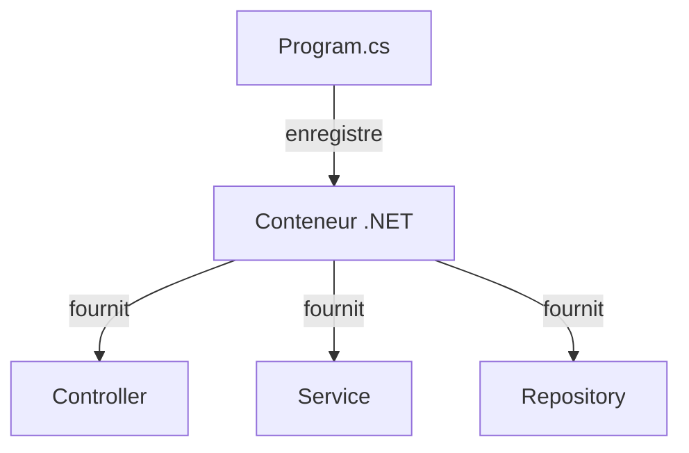

# 07 · L'injection de dépendances

> [!info] À quoi ça sert
> Une classe ne crée pas elle-même ce dont elle a besoin : elle le **demande dans son constructeur**, et .NET le lui fournit. C'est ce qui relie controller, service et repository.

## 1. Sans injection

```csharp
public class ProductService
{
    private readonly ProductRepository _repo = new ProductRepository();   // ❌ figé
}
```

Impossible de remplacer `ProductRepository` (par un faux en test, par une autre base).

## 2. Avec injection

```csharp
public class ProductService : IProductService
{
    private readonly IProductRepository _repository;

    public ProductService(IProductRepository repository)   // ✅ je demande
    {
        _repository = repository;
    }
}
```

Et dans `Program.cs`, on dit **quelle classe** donner pour **quelle interface** :

```csharp
builder.Services.AddScoped<IProductRepository, ProductRepository>();
builder.Services.AddScoped<IProductService, ProductService>();
```



## 3. Combien de temps vit l'objet

| Méthode | Un objet… | Pour |
|---|---|---|
| `AddScoped` | **par requête** | services, repositories, `DbContext` |
| `AddSingleton` | pour **toute l'appli** | cache, configuration |
| `AddTransient` | à **chaque** demande | petits outils sans état |

## 4. Le constructeur raccourci (C# 12)

```csharp
public class ProductService(IProductRepository repository) : IProductService
{
    public Task<Product?> Get(int id) => repository.GetByIdAsync(id);
}
```

Même chose, écrit plus court : tu le verras dans les projets récents.

## À retenir
- On demande des **interfaces** dans le constructeur.
- On choisit la classe à **un seul endroit** : `Program.cs`.
- Pour trouver la vraie classe derrière `IXxx` : chercher `AddScoped<IXxx`.

> [!warning] Piège
> `Unable to resolve service for type 'IXxx'` = l'interface n'est pas enregistrée dans `Program.cs`.

## Concepts
[[Service et injection de dépendances]] · [[Interface et polymorphisme]]

---
← [[Cours - .NET 06 - Exceptions et logs|Exceptions et logs]] · [[Cours - .NET - le plan|Le plan]] · [[Cours - .NET 08 - Program.cs et la configuration|Program.cs et la configuration]] →
