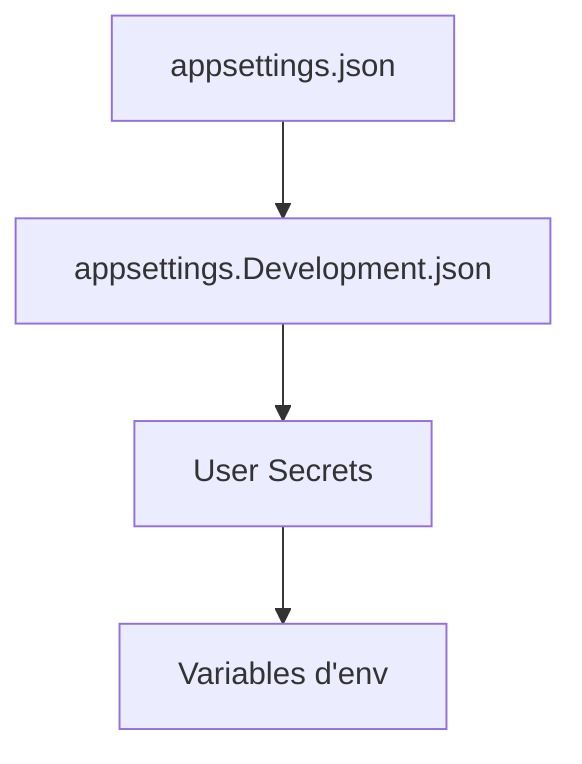

# 08 · Program.cs et la configuration

> [!info] À quoi ça sert
> `Program.cs` est le **tableau de bord** de l'API : on y voit tout ce qui est branché. La configuration dit à l'API où est la base, quelles clés utiliser, sans les écrire dans le code.

## 1. Program.cs en deux parties

```csharp
var builder = WebApplication.CreateBuilder(args);

// ── 1. Je déclare les services ──────────────────────
builder.Services.AddControllers();
builder.Services.AddEndpointsApiExplorer();
builder.Services.AddSwaggerGen();
builder.Services.AddDbContext<AppDbContext>(o =>
    o.UseNpgsql(builder.Configuration.GetConnectionString("Default")));
builder.Services.AddScoped<IProductService, ProductService>();
builder.Services.AddAuthentication(/* … */);

var app = builder.Build();

// ── 2. Je règle le chemin de chaque requête (middlewares) ──
if (app.Environment.IsDevelopment())
{
    app.UseSwagger();
    app.UseSwaggerUI();
}
app.UseHttpsRedirection();
app.UseCors();
app.UseAuthentication();     // qui es-tu ?
app.UseAuthorization();      // as-tu le droit ?
app.MapControllers();        // branche les controllers

app.Run();
```

L'**ordre** des `Use…` compte : chaque requête les traverse de haut en bas.

## 2. Lire la configuration

`appsettings.json` :

```json
{
  "ConnectionStrings": { "Default": "Host=localhost;Database=shop" },
  "Storage": { "MaxFileSizeMb": 20 }
}
```

```csharp
var cs = builder.Configuration.GetConnectionString("Default");
var max = builder.Configuration.GetValue<int>("Storage:MaxFileSizeMb");   // : = niveau
```

Mieux, une classe d'options injectée :

```csharp
public class StorageOptions { public int MaxFileSizeMb { get; set; } }

builder.Services.Configure<StorageOptions>(builder.Configuration.GetSection("Storage"));

public class FileService(IOptions<StorageOptions> options)
{
    private readonly int _max = options.Value.MaxFileSizeMb;
}
```

## 3. Qui gagne ?



La **dernière** gagne. `Storage:MaxFileSizeMb` s'écrit `Storage__MaxFileSizeMb` en variable d'environnement.

```shell
dotnet user-secrets set "ConnectionStrings:Default" "Host=localhost;Password=…"
```

Les **User Secrets** sont hors du dépôt : c'est là qu'on met les mots de passe en local.

## 4. Les ports

`Properties/launchSettings.json` définit les profils (`http`, `https`) et leurs ports. Ils s'affichent au démarrage : `Now listening on: http://localhost:5218`.

## À retenir
- Haut de `Program.cs` = services, bas = middlewares.
- `UseAuthentication` avant `UseAuthorization`.
- Mots de passe : User Secrets ou variables d'environnement, jamais `appsettings.json`.

> [!warning] Piège
> Ajouter un service **après** `builder.Build()` : trop tard, ça plante au démarrage.

## Concepts
[[Middleware]] · [[Variable d'environnement]] · [[Secret et fichier .env]]

---
← [[Cours - .NET 07 - L'injection de dépendances|L'injection de dépendances]] · [[Cours - .NET - le plan|Le plan]] · [[Cours - .NET 09 - Controllers, routes et attributs|Controllers, routes et attributs]] →
