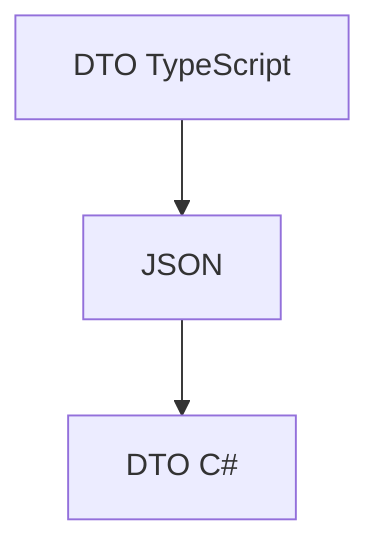

# 10 · DTO et validation

> [!info] À quoi ça sert
> Un **DTO** (Data Transfer Object) est la forme des données qui **entrent** ou **sortent** de l'API. Il protège la base : le client ne voit et n'envoie que ce qu'on a prévu. La **validation** refuse ce qui est faux avant d'entrer dans le code.

## 1. Entité ≠ DTO

```csharp
// L'entité : ce qui est en base (chapitre 11)
public class Product
{
    public int Id { get; set; }
    public string Name { get; set; } = "";
    public decimal Price { get; set; }
    public decimal PurchaseCost { get; set; }   // interne : ne doit pas sortir
}

// Ce que le client reçoit
public record ProductDto(int Id, string Name, decimal Price);

// Ce que le client envoie pour créer
public record CreateProductDto(string Name, decimal Price);
```

Passer de l'un à l'autre :

```csharp
var dto = new ProductDto(product.Id, product.Name, product.Price);
var dtos = products.Select(p => new ProductDto(p.Id, p.Name, p.Price)).ToList();
```

(Certaines équipes utilisent une bibliothèque comme AutoMapper ou Mapster pour ça.)

## 2. Valider avec des attributs

```csharp
public class CreateProductDto
{
    [Required]                       // obligatoire
    [StringLength(100, MinimumLength = 1)]
    public string Name { get; set; } = "";

    [Range(0.01, 10000)]             // entre deux valeurs
    public decimal Price { get; set; }

    [EmailAddress]
    public string? SupplierEmail { get; set; }

    [JsonPropertyName("file_name")]  // nom du champ dans le JSON
    public string? FileName { get; set; }
}
```

Avec `[ApiController]`, si une règle échoue : **400 automatique**, la méthode n'est même pas appelée.

```json
{ "errors": { "Name": ["The Name field is required."] }, "status": 400 }
```

Certaines équipes utilisent **FluentValidation** (règles écrites en code dans une classe `…Validator`) : même rôle.

## 3. Un DTO en front, un DTO en back

Le front (TS) et le back (C#) ne partagent pas de code : chacun décrit le même **JSON**.



```ts
type CreateProductDto = { name: string; price: number };   // front
```
```json
{ "name": "Clavier", "price": 29.9 }
```
```csharp
public record CreateProductDto(string Name, decimal Price);  // back
```

Les majuscules suivent la convention de chaque langage (camelCase en TS, PascalCase en C#). ASP.NET Core **convertit tout seul** : il lit le JSON sans tenir compte des majuscules, et écrit ses réponses en camelCase. Si le nom diffère vraiment : `[JsonPropertyName("file_name")]`.

| Différence entre les deux DTO | Côté back |
|---|---|
| champ en plus dans le front | ignoré |
| champ manquant | valeur par défaut (`null`, `0`), ou **400** s'il est obligatoire |
| nom différent | comme un champ manquant : valeur vide, **sans erreur** |
| type différent (`"abc"` pour un nombre) | **400** |
| seulement la majuscule | ✅ marche |

Vérifier : Swagger montre le JSON attendu, F12 → Réseau → Charge utile montre ce que le front envoie.

## À retenir
- Entité = la base, DTO = ce qui voyage en JSON.
- Un DTO par usage : lecture, création, modification.
- Les attributs `[Required]`, `[Range]`… valident tout seuls.

> [!warning] Piège
> Renvoyer l'entité directement : les champs internes (coût, mot de passe, id technique) partent dans la réponse.

Côté front, le même rôle est tenu par Zod : [[Fiche - Zod, valider les données en TypeScript]].

## Concepts
[[Validation des données]]

---
← [[Cours - .NET 09 - Controllers, routes et attributs|Controllers, routes et attributs]] · [[Cours - .NET - le plan|Le plan]] · [[Cours - .NET 11 - EF Core, la base de données|EF Core, la base de données]] →
