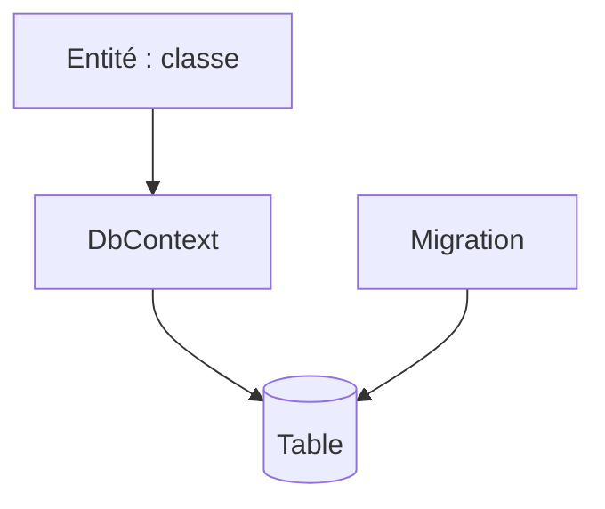

# 11 · EF Core, la base de données

> [!info] À quoi ça sert
> **Entity Framework Core** (EF Core) fait le lien entre les **classes C#** et les **tables SQL**. On écrit du LINQ, il génère le SQL. Les **migrations** font évoluer les tables quand les classes changent.

## 1. Les trois pièces



```csharp
// L'entité = une table
public class Product
{
    public int Id { get; set; }                 // clé primaire (convention : Id)
    public string Name { get; set; } = "";
    public int CategoryId { get; set; }         // clé étrangère
    public Category Category { get; set; } = null!;   // la ligne liée : PAS une colonne
}

// Le DbContext = la connexion, une propriété DbSet par table
public class AppDbContext : DbContext
{
    public AppDbContext(DbContextOptions<AppDbContext> options) : base(options) { }

    public DbSet<Product> Products => Set<Product>();
    public DbSet<Category> Categories => Set<Category>();

    protected override void OnModelCreating(ModelBuilder model)   // réglages fins
    {
        model.Entity<Product>().Property(p => p.Name).HasMaxLength(100);
    }
}
```

## 2. Lire

```csharp
var all = await _context.Products.ToListAsync();
var one = await _context.Products.FirstOrDefaultAsync(p => p.Id == id);
var cheap = await _context.Products
    .Where(p => p.Price < 50)
    .Include(p => p.Category)        // charge aussi la catégorie (jointure)
    .AsNoTracking()                  // lecture seule, plus rapide
    .ToListAsync();
```

Rien ne part en base avant `ToListAsync()`, `FirstOrDefaultAsync()`, `CountAsync()`… Avant, on construit seulement la requête.

## 3. Écrire

```csharp
_context.Products.Add(new Product { Name = "Clavier" });   // ajouter
product.Price = 25m;                                       // modifier (suivi automatique)
_context.Products.Remove(product);                         // supprimer
await _context.SaveChangesAsync();                         // ← ICI le SQL part
```

![[Entité et table.png]]

> [!tip] Propriété de navigation
> `Category Category` n'est pas une colonne : EF s'en sert pour faire le lien avec `CategoryId` et te laisse écrire `product.Category.Name`. Seul `CategoryId` existe en base.
> Si `CategoryId` ne correspond à aucune ligne (par exemple `Guid.Empty`, `0000…`), Postgres **refuse l'INSERT** (clé étrangère).

## 4. Les attributs sur une entité

| Attribut | Sens |
|---|---|
| `[Key]` | clé primaire (si elle ne s'appelle pas `Id`) |
| `[Table("products")]` | nom de la table |
| `[Column("created_at")]` | nom de la colonne |
| `[MaxLength(100)]` | longueur max |
| `[ForeignKey("CategoryId")]` | clé étrangère |
| `[NotMapped]` | pas en base |

## 5. Les migrations

![[Migration EF Core - de ton code à la base.png]]

```shell
dotnet ef migrations add AddProductStock \
  --project MonApp.Infrastructure \
  --startup-project MonApp.Api
```

| Morceau | Rôle |
|---|---|
| `migrations add` | crée une nouvelle migration |
| `AddProductStock` | son nom : dit ce qu'elle fait (`Add…To…`, `Remove…From…`), jamais `Test` |
| `--project` | le projet du `DbContext` : c'est là que le dossier `Migrations/` est écrit |
| `--startup-project` | le projet qui démarre (Api) : il a la chaîne de connexion et l'injection, nécessaires pour construire le `DbContext` |

`dotnet ef` **compile** le projet avant d'agir : si le code ne compile pas, il répond seulement « Build failed », lance `dotnet build` pour voir les erreurs.

### Les 3 fichiers créés

| Fichier | Rôle |
|---|---|
| `2026…_AddProductStock.cs` | **la migration** : `Up()` (appliquer) et `Down()` (annuler). Le seul à relire |
| `2026…_AddProductStock.Designer.cs` | généré, on n'y touche pas |
| `AppDbContextModelSnapshot.cs` | **la photo** du modèle complet, réécrite à chaque migration |

```csharp
public partial class AddProductStock : Migration
{
    // Up : ce qu'on applique
    protected override void Up(MigrationBuilder migrationBuilder)
    {
        migrationBuilder.AddColumn<int>(
            name: "Stock", table: "Products",
            nullable: false, defaultValue: 0);   // valeur des lignes déjà en base
    }

    // Down : comment revenir en arrière
    protected override void Down(MigrationBuilder migrationBuilder)
    {
        migrationBuilder.DropColumn(name: "Stock", table: "Products");
    }
}
```

Une migration décrit **un changement**, pas une table : la base d'aujourd'hui = toutes les migrations appliquées dans l'ordre. Seul le snapshot montre toutes les tables avec toutes leurs colonnes.

### Ce que EF compare, et quand

| Moment | Comparaison |
|---|---|
| `migrations add` | tes entités **vs** le snapshot → le fichier de migration |
| démarrage de l'API (ou `database update`) | les fichiers `Migrations/` **vs** la table `__EFMigrationsHistory` → exécute les `Up()` manquants |

EF ne lit jamais les colonnes réelles : une modification faite à la main dans la base, il ne la voit pas.

Le collègue qui fait `git pull` n'a besoin de rien : sa base se met à jour au démarrage de l'API (si l'API appelle `context.Database.Migrate()`). `dotnet-ef` ne sert qu'à celui qui **crée** la migration.

### Annuler une migration

![[Migration EF Core - annuler.png]]

```shell
# 1. Seulement si l'API a tourné : revenir à la migration d'avant (exécute Down())
dotnet ef database update AddCategory --project MonApp.Infrastructure --startup-project MonApp.Api

# 2. Supprimer la dernière migration (fichiers + snapshot remis comme avant)
dotnet ef migrations remove --project MonApp.Infrastructure --startup-project MonApp.Api
```

`migrations remove` enlève toujours **la plus récente**. Il refuse si elle est encore dans `__EFMigrationsHistory`. Pour connaître la migration d'avant :

```shell
docker exec -it postgres psql -U <user> -d <base> \
  -c 'SELECT "MigrationId" FROM "__EFMigrationsHistory" ORDER BY "MigrationId" DESC LIMIT 2;'
```

### Règles pro

| Règle | Sinon… |
|---|---|
| une migration = un changement, avec un nom clair | impossible de savoir ce qu'elle fait |
| relire `Up()` avant de lancer | une colonne d'un collègue part avec la tienne |
| commiter migration + `.Designer` + snapshot + entité ensemble | le prochain qui crée une migration récupère ton changement dans la sienne |
| ne jamais modifier une migration déjà poussée : en créer une nouvelle | les bases des autres ne correspondent plus |
| ne jamais faire d'`ALTER TABLE` à la main | EF ne le sait pas |
| `dotnet-ef` à la **même version** qu'EF Core dans le `.csproj` | le snapshot est réécrit dans un autre format (`(string)null` partout) : du bruit dans le commit |
| ne pas stocker une info qu'une autre colonne donne déjà | une colonne, une migration et du code pour rien |

Si le snapshot apparaît modifié alors que tu n'as plus de migration : `git checkout -- <chemin>/…ModelSnapshot.cs`.

## 6. `dotnet-ef` : quand en a-t-on besoin ?

| Je veux… | `dotnet-ef` ? |
|---|---|
| ajouter des **lignes** dans une table qui existe (`Add` + `SaveChangesAsync`) | ❌ non |
| créer une **table**, ajouter une **colonne** | ✅ oui |

```shell
dotnet tool install --global dotnet-ef --version <version d'EF du projet>
export PATH="$PATH:$HOME/.dotnet/tools"     # sous Linux/WSL, à mettre aussi dans ~/.bashrc
dotnet ef --version
```

« dotnet-ef does not exist » = outil pas installé ou pas dans le PATH.

Une entité n'est vue que si elle a son `DbSet` dans le `DbContext`. Deux écritures, même sens :

```csharp
public DbSet<Product> Products { get; set; }
public DbSet<Product> Products => Set<Product>();
```

## 7. Voir la base

| Je veux… | Commande |
|---|---|
| entrer dans psql | `docker exec -it postgres psql -U <user> -d <base>` |
| lister les tables | `\dt` |
| voir les colonnes d'une table | `\d "Products"` (guillemets : majuscules) |
| voir les dernières lignes | `SELECT * FROM "Products" ORDER BY "Id" DESC LIMIT 5;` |
| quitter | `\q` |

Dans Rider : **View → Tool Windows → Database**, `+` → PostgreSQL, `localhost:5432`, user, base et mot de passe de `appsettings.Development.json`. Si aucune table n'apparaît : clic droit → Properties → onglet **Schemas** → cocher `public`, puis Refresh.

## À retenir
- Entité = table, `DbSet` = accès à la table, `DbContext` = la base.
- `SaveChangesAsync()` enregistre, les `…Async()` de lecture exécutent.
- Changer une entité = créer une migration, et commiter les deux ensemble.
- `migrations add` compare au snapshot ; le démarrage compare à `__EFMigrationsHistory`.
- Annuler : `database update <précédente>` (si appliquée), puis `migrations remove`.

> [!warning] Piège
> Modifier des données sans `SaveChangesAsync()` : aucune erreur, mais rien n'est enregistré.

## Concepts
[[ORM]] · [[Migration de base de données]]

---
← [[Cours - .NET 10 - DTO et validation|DTO et validation]] · [[Cours - .NET - le plan|Le plan]] · [[Cours - .NET 12 - Les couches, controller, service, repository|Les couches, controller, service, repository]] →
