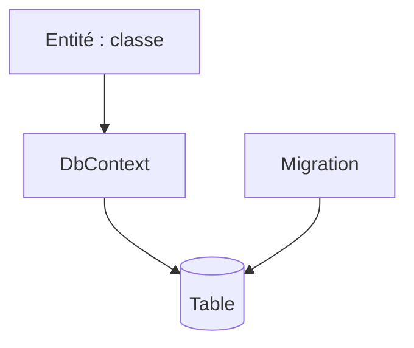
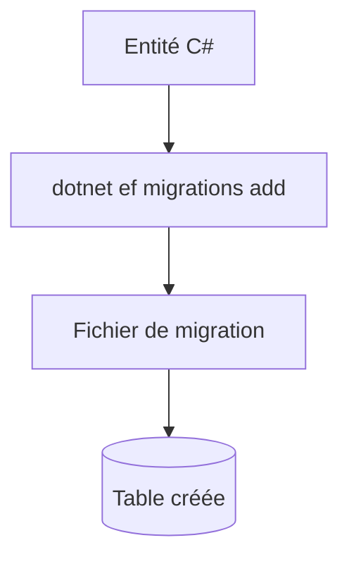

# 11 · EF Core, la base de données

> [!info] À quoi ça sert
> **Entity Framework Core** (EF Core) fait le lien entre les **classes C#** et les **tables SQL**. On écrit du LINQ, il génère le SQL. Les **migrations** font évoluer les tables quand les classes changent.

## 1. Les trois pièces



```csharp
// L'entité = une table
public class Product
{
    public int Id { get; set; }                 // clé primaire (convention : Id)
    public string Name { get; set; } = "";
    public int CategoryId { get; set; }         // clé étrangère
    public Category Category { get; set; } = null!;   // la ligne liée
}

// Le DbContext = la connexion, une propriété DbSet par table
public class AppDbContext : DbContext
{
    public AppDbContext(DbContextOptions<AppDbContext> options) : base(options) { }

    public DbSet<Product> Products => Set<Product>();
    public DbSet<Category> Categories => Set<Category>();

    protected override void OnModelCreating(ModelBuilder model)   // réglages fins
    {
        model.Entity<Product>().Property(p => p.Name).HasMaxLength(100);
    }
}
```

## 2. Lire

```csharp
var all = await _context.Products.ToListAsync();
var one = await _context.Products.FirstOrDefaultAsync(p => p.Id == id);
var cheap = await _context.Products
    .Where(p => p.Price < 50)
    .Include(p => p.Category)        // charge aussi la catégorie (jointure)
    .AsNoTracking()                  // lecture seule, plus rapide
    .ToListAsync();
```

Rien ne part en base avant `ToListAsync()`, `FirstOrDefaultAsync()`, `CountAsync()`… Avant, on construit seulement la requête.

## 3. Écrire

```csharp
_context.Products.Add(new Product { Name = "Clavier" });   // ajouter
product.Price = 25m;                                       // modifier (suivi automatique)
_context.Products.Remove(product);                         // supprimer
await _context.SaveChangesAsync();                         // ← ICI le SQL part
```

## 4. Les attributs sur une entité

| Attribut | Sens |
|---|---|
| `[Key]` | clé primaire (si elle ne s'appelle pas `Id`) |
| `[Table("products")]` | nom de la table |
| `[Column("created_at")]` | nom de la colonne |
| `[MaxLength(100)]` | longueur max |
| `[ForeignKey("CategoryId")]` | clé étrangère |
| `[NotMapped]` | pas en base |

## 5. Les migrations

```shell
dotnet tool install --global dotnet-ef        # une fois

dotnet ef migrations add AddProductStock \
  --project MonApp.Infrastructure \
  --startup-project MonApp.Api                # crée un fichier de migration

dotnet ef database update \
  --project MonApp.Infrastructure \
  --startup-project MonApp.Api                # l'applique
```

La table `__EFMigrationsHistory` garde la liste des migrations déjà appliquées. Beaucoup d'API les appliquent au démarrage (`context.Database.Migrate()` dans `Program.cs`).

## 6. `dotnet-ef` : quand en a-t-on besoin ?

`dotnet-ef` lit tes **entités** et le `DbContext`, les compare à l'état de la dernière migration, et écrit un fichier de migration avec **la différence**. Comme `prisma migrate` en JS.



| Je veux… | `dotnet-ef` ? |
|---|---|
| ajouter des **lignes** dans une table qui existe (`Add` + `SaveChangesAsync`) | ❌ non |
| créer une **table**, ajouter une **colonne** | ✅ oui |

Une entité n'est vue que si elle a son `DbSet` dans le `DbContext`. Deux écritures, même sens :

```csharp
public DbSet<Product> Products { get; set; }
public DbSet<Product> Products => Set<Product>();
```

Rider propose « install dotnet-ef as a global tool » dès qu'il voit EF Core : global = installé une fois pour la machine (`dotnet tool install --global dotnet-ef`, même version majeure que le projet).

## À retenir
- Entité = table, `DbSet` = accès à la table, `DbContext` = la base.
- `SaveChangesAsync()` enregistre, les `…Async()` de lecture exécutent.
- Changer une entité = créer une migration, et commiter les deux ensemble.

> [!warning] Piège
> Modifier des données sans `SaveChangesAsync()` : aucune erreur, mais rien n'est enregistré.

## Concepts
[[ORM]] · [[Migration de base de données]]

---
← [[Cours - .NET 10 - DTO et validation|DTO et validation]] · [[Cours - .NET - le plan|Le plan]] · [[Cours - .NET 12 - Les couches, controller, service, repository|Les couches, controller, service, repository]] →
