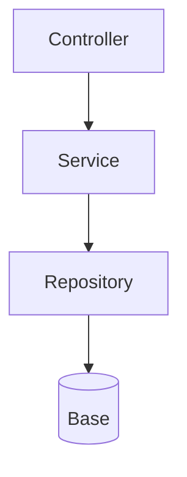

# 12 · Les couches : controller, service, repository

> [!info] À quoi ça sert
> Ranger le code pour que chaque partie ait **un seul rôle**. On sait où chercher, on peut tester la logique sans HTTP ni base, et changer une couche sans casser les autres.

## 1. Le chemin

> [!todo] Mon schéma
> Front → Controller → Service → Repository → base, puis le retour avec l'Id.



| Couche | Rôle | Ne fait **pas** |
|---|---|---|
| Controller | HTTP : recevoir, renvoyer un code | règle métier, SQL |
| Service | la logique métier | HTTP, SQL |
| Repository | lire et écrire en base | règle métier |

## 2. La même fonctionnalité, couche par couche

**Repository** : seulement la base.

```csharp
public interface IProductRepository
{
    Task<Product?> GetByIdAsync(int id);
    Task<bool> ExistsByNameAsync(string name);
    Task AddAsync(Product product);
}

public class ProductRepository(AppDbContext context) : IProductRepository
{
    public Task<Product?> GetByIdAsync(int id) =>
        context.Products.FirstOrDefaultAsync(p => p.Id == id);

    public Task<bool> ExistsByNameAsync(string name) =>
        context.Products.AnyAsync(p => p.Name == name);

    public async Task AddAsync(Product product)
    {
        context.Products.Add(product);
        await context.SaveChangesAsync();
    }
}
```

**Service** : les règles.

```csharp
public interface IProductService
{
    Task<ProductDto> CreateAsync(CreateProductDto dto);
}

public class ProductService(IProductRepository repository) : IProductService
{
    public async Task<ProductDto> CreateAsync(CreateProductDto dto)
    {
        // règle métier : pas deux produits avec le même nom
        if (await repository.ExistsByNameAsync(dto.Name))
            throw new InvalidOperationException($"Product {dto.Name} already exists");

        var product = new Product { Name = dto.Name, Price = dto.Price };
        await repository.AddAsync(product);
        return new ProductDto(product.Id, product.Name, product.Price);
    }
}
```

**Controller** : HTTP.

```csharp
[HttpPost]
public async Task<ActionResult<ProductDto>> Create([FromBody] CreateProductDto dto)
{
    try
    {
        var created = await _service.CreateAsync(dto);
        return CreatedAtAction(nameof(GetById), new { id = created.Id }, created);
    }
    catch (InvalidOperationException ex)
    {
        return Conflict(ex.Message);   // 409
    }
}
```

**Program.cs** : on branche.

```csharp
builder.Services.AddScoped<IProductRepository, ProductRepository>();
builder.Services.AddScoped<IProductService, ProductService>();
```

> [!tip] L'Id vient d'en bas
> Le repository de base fait souvent :
> ```csharp
> public async Task<T?> AddAsync(T entity)
> {
>     if (entity.Id == Guid.Empty) entity.Id = Guid.NewGuid();   // l'Id est créé ici
>     await _context.AddAsync(entity);
>     await _context.SaveChangesAsync();
>     return entity;                                            // et renvoyé
> }
> ```
> Pour que le controller l'ait, chaque couche doit **retourner** ce qu'elle reçoit : `return await repository.AddAsync(...)` dans le service (type `Task<Product?>`, dans l'interface **et** la classe), `var created = await service...` dans le controller. Les appels existants qui ignorent le résultat ne cassent pas. Le front n'envoie jamais d'id pour une création.

## 3. Les projets de la solution

| Projet souvent nommé | Contient |
|---|---|
| `*.Api` | controllers, `Program.cs`, `appsettings` |
| `*.Application` | services, interfaces, DTO |
| `*.Core` ou `*.Domain` | entités |
| `*.Infrastructure` | `DbContext`, repositories, migrations |

`Api` → `Application` → `Core`. `Core` ne dépend de personne.

## 4. Ajouter une fonctionnalité

| # | Je crée | Où |
|---|---|---|
| 1 | l'entité | Core |
| 2 | le `DbSet` + la migration | Infrastructure |
| 3 | le repository (interface + classe) | Infrastructure |
| 4 | les DTO, le service (interface + classe) | Application |
| 5 | l'enregistrement dans `Program.cs` | Api |
| 6 | le controller et la route | Api |
| 7 | le test dans Swagger | — |

Astuce : ouvrir une fonctionnalité qui existe et suivre ses appels avec **F12** (aller à la définition).

## À retenir
- Chaque couche n'appelle que celle du dessous.
- La règle métier est dans le service, nulle part ailleurs.
- On suit toujours le chemin d'une fonctionnalité existante.

> [!warning] Piège
> Le controller qui appelle directement le `DbContext` : ça marche, mais la règle métier est sautée et le code n'est plus testable.

Règles détaillées : [[Bonnes pratiques - .NET]].

## Concepts
[[Architecture en couches]] · [[Patron Dépôt (Repository)]]

---
← [[Cours - .NET 11 - EF Core, la base de données|EF Core, la base de données]] · [[Cours - .NET - le plan|Le plan]] · [[Cours - .NET 13 - Authentification et Authorize|Authentification et Authorize]] →
