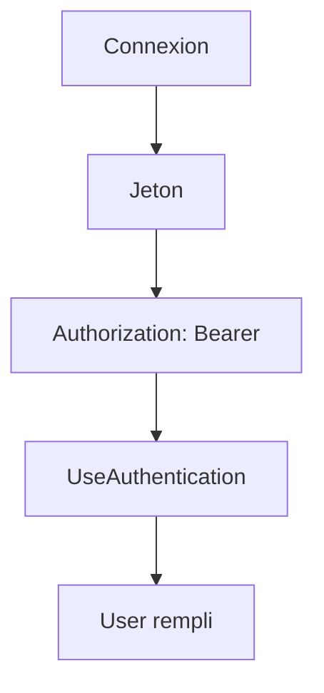

# 13 · Authentification et `[Authorize]`

> [!info] À quoi ça sert
> Savoir **qui** appelle l'API et **s'il a le droit**. Le client envoie un **jeton** (souvent un JWT) à chaque requête ; .NET le vérifie et remplit `User`.

## 1. Le chemin du jeton



Le front ajoute l'en-tête à chaque requête :

```http
GET /api/products
Authorization: Bearer eyJhbGciOi...
```

## 2. Protéger une route

```csharp
[Authorize]                                   // toute la classe : connecté obligatoire
public class ProductsController : ControllerBase
{
    [AllowAnonymous]                          // sauf celle-ci
    [HttpGet]
    public IActionResult GetAll() => Ok();

    [Authorize(Roles = "Admin")]              // connecté ET admin
    [HttpDelete("{id:int}")]
    public IActionResult Delete(int id) => NoContent();

    [Authorize(Policy = "CanEdit")]           // règle nommée, définie dans Program.cs
    [HttpPut("{id:int}")]
    public IActionResult Update(int id) => NoContent();
}
```

| Code | Sens |
|---|---|
| **401** | pas de jeton ou jeton invalide : « qui es-tu ? » |
| **403** | jeton valide mais pas le droit : « je sais qui tu es, mais non » |

## 3. Savoir qui appelle

```csharp
var userId   = User.FindFirst(ClaimTypes.NameIdentifier)?.Value;
var email    = User.FindFirst(ClaimTypes.Email)?.Value;
var name     = User.Identity?.Name;
bool isAdmin = User.IsInRole("Admin");
```

Les **claims** sont les informations écrites dans le jeton (id, email, rôles). Le nom exact des claims dépend du fournisseur (Keycloak, Azure AD…) : regarder un jeton sur jwt.io pour les voir.

## 4. Dans Program.cs

```csharp
builder.Services
    .AddAuthentication(JwtBearerDefaults.AuthenticationScheme)
    .AddJwtBearer(o =>
    {
        o.Authority = builder.Configuration["Auth:Authority"];   // qui délivre les jetons
        o.Audience  = builder.Configuration["Auth:Audience"];
    });
builder.Services.AddAuthorization(o =>
    o.AddPolicy("CanEdit", p => p.RequireRole("Admin", "Editor")));

app.UseAuthentication();
app.UseAuthorization();
```

## À retenir
- `[Authorize]` = jeton obligatoire, `[AllowAnonymous]` = l'exception.
- Qui appelle : `User`, lu dans le jeton, jamais envoyé par le front dans le corps.
- 401 = pas connecté, 403 = pas le droit.

> [!warning] Piège
> Dans Swagger, une route `[Authorize]` répond 401 : cliquer sur **Authorize** et coller un jeton.

## Concepts
[[Authentification]] · [[JWT]] · [[Middleware]]

---
← [[Cours - .NET 12 - Les couches, controller, service, repository|Les couches, controller, service, repository]] · [[Cours - .NET - le plan|Le plan]] · [[Cours - .NET 14 - Tester avec xUnit|Tester avec xUnit]] →
