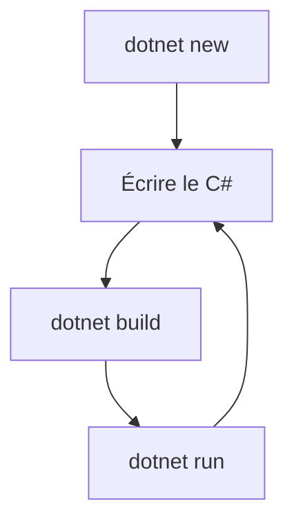

# Cours - .NET, premiers pas

> [!abstract] Objectifs
> - Savoir ce que sont .NET, C#, le SDK et le runtime
> - Créer, lancer et compiler un projet avec la commande `dotnet`
> - Lire la structure d'un projet et d'une solution
> - Ajouter un paquet NuGet

**Prérequis :** [[Terminal]] · [[Cours - Programmer dans n'importe quel langage]]

## 1. .NET en une image
Tu écris du **C#** (fichiers `.cs`). Le **SDK** le compile en un fichier `.dll`. Le **runtime** exécute ce `.dll`, sous Windows comme sous Linux. Tout est piloté par une seule commande : `dotnet`. Détails : [[Plateforme .NET]].

## 2. Schéma


## 3. Compilé : ce que ça change par rapport à Python
En Python, tu lances le script et une faute de frappe ne se voit qu'en arrivant sur la ligne. En C#, `dotnet build` vérifie **tout le code avant** : un nom mal écrit ou un mauvais type, et rien ne se lance. C'est plus strict au début, mais beaucoup d'erreurs disparaissent avant l'exécution. Voir [[Langage compilé et interprété]].

> [!tip] Lire une erreur de compilation
> `Program.cs(12,9): error CS0103: The name 'totl' does not exist…` : fichier, ligne 12, colonne 9, code d'erreur, message. Corrige toujours la **première** erreur de la liste d'abord. Méthode générale : [[Fiche - Lire un message d'erreur]].

## 4. Installer et vérifier
- Installer le **SDK** (pas seulement le runtime) : sous Ubuntu ou WSL `sudo apt install dotnet-sdk-8.0`, sous Windows l'installateur officiel.
- Vérifier : `dotnet --version`.
- Éditeur : VS Code avec l'extension **C# Dev Kit**, ou Visual Studio, ou Rider. La complétion et le soulignement des erreurs en direct aident énormément en C#.

## 5. Le premier projet
```bash
dotnet new console -o Bonjour
cd Bonjour
dotnet run
```
Trois fichiers à regarder :
- `Bonjour.csproj` : la carte d'identité du projet (version de .NET, paquets).
- `Program.cs` : le code. Une seule ligne suffit, `Console.WriteLine("Hello, World!");` : c'est le point d'entrée.
- `bin/` et `obj/` : ce que produit la compilation. Jamais dans Git.

Commandes : [[dotnet new]] · [[dotnet run]] · [[dotnet build]].

## 6. Projet, solution, référence
Dès qu'il y a plus d'un morceau (une bibliothèque, une API, des tests), on crée une **solution** qui les regroupe, et des **références** entre projets. La règle : le cœur (les classes et les règles) ne dépend de rien ; l'API et les tests dépendent du cœur. Voir [[Projet et solution .NET]].

## 7. Les paquets : NuGet
Comme pip pour Python ou npm pour JavaScript, **NuGet** installe des bibliothèques externes : `dotnet add package <nom>`. La liste est dans le `.csproj`. Voir [[Gestionnaire de paquets]] et [[dotnet add]].

## Mise en pratique
- Pour chaque notion du cours : les **exercices visuels** de sa fiche (section 3).
- Puis [[Découvrir .NET 01 - Un premier programme console]] et [[Découvrir .NET 02 - Une solution en deux projets]].

> [!warning] Erreurs fréquentes
> - Installer le runtime au lieu du SDK : `dotnet new` et `dotnet build` n'existent pas
> - Lancer `dotnet run` à la racine d'une solution : il faut `--project`
> - Commiter `bin/` et `obj/` : lance `dotnet new gitignore` dès le début
> - Confondre .NET Framework (ancien, Windows seulement) et .NET (moderne) en lisant un tutoriel ou une réponse en ligne : regarde la date et la version

## Résumé
Pas de résumé à écrire : si tu veux, fais un dessin Excalidraw qui relie les notions ci-dessous.

## Concepts du cours
[[Plateforme .NET]] · [[Langage compilé et interprété]] · [[Projet et solution .NET]] · [[Gestionnaire de paquets]]
