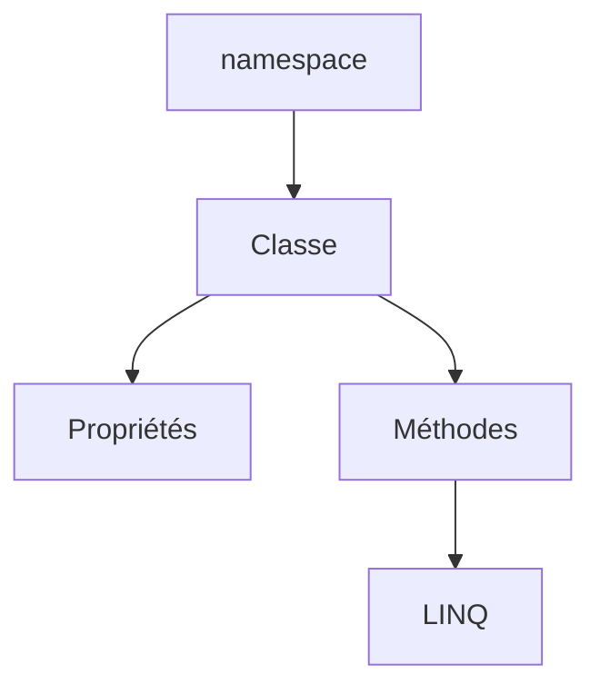

# Cours - Lire et écrire du code .NET

> [!abstract] Objectifs
> - Retrouver en C# les briques que tu connais déjà en Python
> - Comprendre ce que le typage statique t'impose et t'apporte
> - Lire du code C# courant : classes, propriétés, `List`, LINQ, `try/catch`, `async`

**Prérequis :** [[Cours - .NET, premiers pas]]

> [!info] Comment lire ce cours
> Tu ne découvres pas de nouvelles notions : une variable, une classe ou une exception sont les mêmes idées qu'en Python. Pour chacune, ouvre la fiche et déplie l'encadré **« Comment ça s'écrit »** : la version C# y est. Ce cours dit seulement ce qui **change** en C#.

## 1. Schéma

## 2. Tout est typé
Chaque variable, paramètre et retour a un type, vérifié à la compilation. `var` laisse le compilateur deviner le type, mais il reste fixé. Pour l'argent, `decimal` (avec `m` : `12.50m`), jamais `double`. Le `?` (`string?`) dit qu'une valeur peut être `null` ; l'éditeur te prévient si tu oublies de le vérifier. Fiche : [[Variables et types]].

## 3. Des accolades et des points-virgules
Les blocs sont entre `{ }` (l'indentation ne compte pas pour le compilateur, mais garde-la pour les humains), chaque instruction finit par `;`. Les conditions et les boucles ressemblent à JavaScript. Fiches : [[Condition (if)]] · [[Boucle (for, while)]].

## 4. Tout vit dans une classe
Une fonction est toujours une **méthode** d'une classe. Les classes sont rangées dans des **namespaces** (`using` pour les utiliser). Une classe a des **propriétés** (`{ get; set; }`) et des méthodes ; `public` et `private` disent qui peut y toucher. Pour des données simples, un `record` suffit. Fiches : [[Fonction]] · [[Classe et objet]] · [[Module et import]].

## 5. Les collections et LINQ
`List<T>` et `Dictionary<TKey, TValue>` remplacent la liste et le dictionnaire Python ; le type des éléments est entre `< >`. Pour filtrer, transformer, additionner ou regrouper, on n'écrit presque jamais la boucle : on utilise **LINQ** (`Where`, `Select`, `Sum`, `GroupBy`). Fiches : [[Liste et dictionnaire]] · [[Motifs de boucle]].

## 6. Les erreurs
Même idée qu'en Python : `try / catch / finally`, `throw`. On attrape un type précis d'exception. Fiche : [[Exception]].

## 7. Les interfaces
Très utilisées en .NET : on écrit le code contre une interface (`IStockage`) et on choisit l'implémentation au démarrage. C'est ce qui rend le code testable et ce qu'utilise l'injection de dépendances du cours suivant. Fiche : [[Interface et polymorphisme]].

## 8. L'asynchrone
Tout ce qui attend (réseau, fichier, base de données) existe en version `…Async` qui renvoie une `Task`. On l'appelle avec `await`, dans une méthode marquée `async`. Fiche : [[async et await]].

## Pièges
> [!warning] Erreurs fréquentes
> - Oublier un `;` ou une `}` : le compilateur pointe souvent la ligne **suivante**
> - Comparer deux textes sans faire attention à la casse : `string.Equals(a, b, StringComparison.OrdinalIgnoreCase)`
> - Écrire une boucle `foreach` avec un `if` et un compteur là où un `Where(...).Count()` suffit
> - Ignorer les avertissements jaunes de nullabilité (`CS8602`) : ce sont les futurs `NullReferenceException`
> - Bloquer avec `.Result` sur une `Task` au lieu d'utiliser `await`

## Aide-mémoire
Toute la syntaxe en tableaux : [[Fiche - Syntaxe C# en un coup d'œil]].

## Concepts du cours
[[Variables et types]] · [[Fonction]] · [[Classe et objet]] · [[Liste et dictionnaire]] · [[Motifs de boucle]] · [[Exception]] · [[Interface et polymorphisme]] · [[async et await]] · [[Module et import]]
