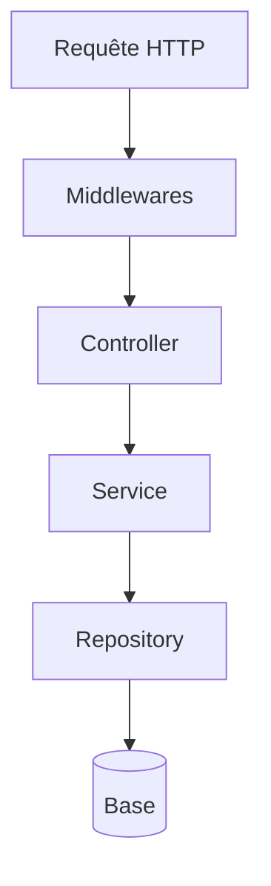

# Cours - Lire le code d'un backend ASP.NET Core

> [!abstract] Objectifs
> - Ouvrir **n'importe quel** backend .NET et comprendre ce que fait chaque ligne
> - Reconnaître ce qui vient de .NET (attributs, classes de base, méthodes toutes faites) et ce qui vient de l'équipe
> - Savoir où chercher quand on doit ajouter une route

**Prérequis :** [[Cours - Lire et écrire du code .NET]] · [[Cours - Une API web avec ASP.NET Core]]

## 1. Le chemin d'une requête



Tout ce qui est entre `[ ]`, les classes `ControllerBase`, `DbContext`, `ILogger`, et les méthodes `Ok()`, `NotFound()`… **viennent de .NET**. Le reste (noms de services, entités) vient de l'équipe.

## 2. Un controller, ligne par ligne

```csharp
[ApiController]                                  // ①
[Route("api/[controller]")]                      // ②  → /api/orders
[Authorize]                                      // ③
public class OrdersController : ControllerBase   // ④
{
    private readonly IOrderService _orderService;            // ⑤
    private readonly ILogger<OrdersController> _logger;

    public OrdersController(IOrderService orderService,      // ⑥
                            ILogger<OrdersController> logger)
    {
        _orderService = orderService;
        _logger = logger;
    }

    [HttpGet("{id:int}")]                                     // ⑦ GET /api/orders/12
    [ProducesResponseType(typeof(OrderDto), 200)]
    [ProducesResponseType(404)]
    public async Task<ActionResult<OrderDto>> GetById(int id) // ⑧
    {
        var order = await _orderService.GetByIdAsync(id);
        if (order is null) return NotFound();                 // ⑨ 404
        return Ok(order);                                     //    200 + JSON
    }

    [HttpPost]                                                // POST /api/orders
    public async Task<IActionResult> Create([FromBody] CreateOrderDto dto)  // ⑩
    {
        var userId = User.FindFirst(ClaimTypes.NameIdentifier)?.Value;      // ⑪
        var created = await _orderService.CreateAsync(dto, userId);
        return CreatedAtAction(nameof(GetById), new { id = created.Id }, created); // 201
    }
}
```

| # | Ce que c'est | Ce que ça fait |
|---|---|---|
| ① | attribut `[ApiController]` | valide le JSON tout seul (400 si invalide), lit le corps sans qu'on le dise |
| ② | attribut `[Route]` | l'adresse de base. `[controller]` = le nom de la classe sans « Controller » |
| ③ | attribut `[Authorize]` | toutes les routes demandent un **jeton** valide, sinon **401** |
| ④ | `: ControllerBase` | **hérite** de la classe .NET qui fournit `Ok()`, `NotFound()`, `User`… |
| ⑤ | champs `private readonly _x` | ce dont le controller a besoin, rangé une fois pour toutes |
| ⑥ | constructeur | **injection** : .NET fournit les objets, enregistrés dans `Program.cs` |
| ⑦ | `[HttpGet("{id:int}")]` | méthode + suite de l'adresse. `{id:int}` = un nombre, passé dans `id` |
| ⑧ | `async Task<ActionResult<T>>` | renvoie plus tard soit un `T` (200), soit un autre code |
| ⑨ | `NotFound()`, `Ok(x)` | méthodes de `ControllerBase` qui choisissent le code HTTP |
| ⑩ | `[FromBody]` | remplit `dto` avec le JSON du corps |
| ⑪ | `User` | la personne connectée, lue **dans le jeton** (jamais envoyée par le front) |

> [!info] Les attributs `[ ]`
> Une étiquette posée sur une classe, une méthode ou une propriété. Elle ne fait rien seule : c'est .NET qui la **lit** et agit en conséquence. C'est le même principe que les décorateurs `@Get()` de NestJS ou d'Angular en TypeScript.

## 3. Les attributs à connaître

**Routes et HTTP**

| Attribut | Sens |
|---|---|
| `[ApiController]` | controller d'API (validation auto, 400 auto) |
| `[Route("api/x")]` | adresse de base |
| `[HttpGet]` `[HttpPost]` `[HttpPut]` `[HttpPatch]` `[HttpDelete]` | méthode HTTP (+ suite de l'adresse en option) |
| `[ProducesResponseType(200)]` | documente les codes possibles (sert à Swagger) |
| `[Consumes("multipart/form-data")]` | type de corps attendu (ex. envoi de fichier) |

**D'où vient un paramètre**

| Attribut | Lit dans… | Exemple |
|---|---|---|
| `[FromRoute]` | l'adresse | `/orders/12` → `id = 12` |
| `[FromQuery]` | après le `?` | `/orders?status=paid` |
| `[FromBody]` | le corps JSON | `{ "name": "…" }` |
| `[FromForm]` | un formulaire / fichier | `IFormFile file` |
| `[FromHeader]` | un en-tête | `[FromHeader(Name = "X-Lang")]` |
| `[FromServices]` | un service injecté | rare, pour une seule méthode |

Sans attribut, `[ApiController]` devine : type simple → adresse ou `?`, objet → corps.

**Sécurité**

| Attribut | Sens |
|---|---|
| `[Authorize]` | connecté obligatoire (401 sinon) |
| `[Authorize(Roles = "Admin")]` | connecté **et** avec ce rôle (403 sinon) |
| `[Authorize(Policy = "CanEdit")]` | règle nommée, définie dans `Program.cs` |
| `[AllowAnonymous]` | annule `[Authorize]` pour cette route (ex. login) |

401 = « qui es-tu ? » (pas de jeton), 403 = « je sais qui tu es, mais tu n'as pas le droit ».

**Validation des données (sur les DTO)**

| Attribut | Sens |
|---|---|
| `[Required]` | champ obligatoire |
| `[StringLength(100)]` / `[MaxLength(100)]` | longueur maximale |
| `[Range(1, 10)]` | valeur entre deux bornes |
| `[EmailAddress]` | format email |
| `[JsonPropertyName("file_name")]` | nom du champ dans le JSON |

Avec `[ApiController]`, une règle non respectée → **400** automatique, avant d'entrer dans la méthode.

**Base de données (sur les entités)**

| Attribut | Sens |
|---|---|
| `[Key]` | clé primaire (sinon, la propriété `Id` l'est par convention) |
| `[Table("orders")]` | nom de la table |
| `[Column("created_at")]` | nom de la colonne |
| `[ForeignKey("UserId")]` | clé étrangère |
| `[NotMapped]` | propriété qui n'est **pas** en base |

Souvent, ces réglages sont plutôt écrits en code dans le `DbContext` (`OnModelCreating`) : chercher aussi là.

## 4. `Program.cs` : le tableau de bord

```csharp
var builder = WebApplication.CreateBuilder(args);

builder.Services.AddControllers();                                   // les controllers
builder.Services.AddDbContext<AppDbContext>(o =>
    o.UseNpgsql(builder.Configuration.GetConnectionString("Default"))); // la base
builder.Services.AddScoped<IOrderService, OrderService>();          // interface → classe
builder.Services.AddScoped<IOrderRepository, OrderRepository>();
builder.Services.AddAuthentication(/* JWT… */);
builder.Services.AddSwaggerGen();

var app = builder.Build();

app.UseSwagger(); app.UseSwaggerUI();
app.UseAuthentication();   // lit le jeton
app.UseAuthorization();    // applique [Authorize]
app.MapControllers();      // branche les routes
app.Run();
```

| Je cherche… | Je regarde |
|---|---|
| quelle classe se cache derrière `IOrderService` | `AddScoped<IOrderService, …>` |
| comment l'API se connecte à la base | `AddDbContext` + `GetConnectionString` |
| comment le jeton est vérifié | `AddAuthentication` |
| pourquoi mon `[Authorize]` ne marche pas | `UseAuthentication` **avant** `UseAuthorization` |

Durée de vie d'un service :

| Méthode | Un objet… | Pour |
|---|---|---|
| `AddScoped` | **par requête** | services, repositories, `DbContext` (le plus courant) |
| `AddSingleton` | **pour toute l'appli** | cache, configuration |
| `AddTransient` | **à chaque demande** | petits objets sans état |

Erreur `Unable to resolve service for type 'IXxx'` = l'interface n'est pas enregistrée ici.

## 5. Le repository et EF Core

```csharp
public class OrderRepository : IOrderRepository
{
    private readonly AppDbContext _context;
    public OrderRepository(AppDbContext context) => _context = context;

    public Task<Order?> GetByIdAsync(int id) =>
        _context.Orders.FirstOrDefaultAsync(o => o.Id == id);

    public async Task AddAsync(Order order)
    {
        _context.Orders.Add(order);
        await _context.SaveChangesAsync();   // c'est ICI que le SQL part
    }
}
```

| Code | Sens |
|---|---|
| `class AppDbContext : DbContext` | la connexion à la base |
| `DbSet<Order> Orders` | une table |
| `.Where(o => …)` `.OrderBy(…)` | filtre, tri (traduits en SQL) |
| `.ToListAsync()` `.FirstOrDefaultAsync()` | **exécute** la requête |
| `.Include(o => o.Items)` | charge aussi la table liée (une jointure) |
| `.Add()` `.Remove()` puis `SaveChangesAsync()` | prépare puis **enregistre** |
| `.AsNoTracking()` | lecture seule, plus rapide |

> [!tip] Rien ne part en base avant `ToListAsync()`, `FirstOrDefaultAsync()` ou `SaveChangesAsync()`. Avant, on construit seulement la requête.

## 6. Ce qu'on voit partout dans le code

| Écriture | Sens |
|---|---|
| `IOrderService` | une **interface** (contrat). Le `I` devant est la convention |
| `OrderService : IOrderService` | la classe qui **remplit** le contrat |
| `OrderDto`, `CreateOrderDto` | objet qui voyage en JSON (pas l'entité de la base) |
| `public record OrderDto(int Id, string Name);` | petite classe de données en une ligne |
| `string?` | peut être `null` |
| `x!` | « je promets que ce n'est pas null » |
| `public int Id { get; set; }` | propriété lisible et modifiable |
| `{ get; init; }` | modifiable seulement à la création |
| `=> …` | corps d'une méthode en une ligne |
| `nameof(GetById)` | le nom en texte, vérifié à la compilation |
| `List<T>`, `Task<T>` | **générique** : `T` est le type contenu |
| `CancellationToken ct` | permet d'annuler si le client part |
| `namespace X.Y;` + `using X.Y;` | rangement du code et import |
| `public static … this Type x` | **méthode d'extension** : ajoute une méthode à un type existant (`services.AddMyStuff()`) |
| `partial class` | classe découpée en plusieurs fichiers |
| `_logger.LogInformation("… {Id}", id)` | log structuré, `{Id}` est remplacé |

## 7. Où ranger quoi

| Couche | Projet souvent nommé | Contient |
|---|---|---|
| Controller | `*.Api` | controllers, `Program.cs`, `appsettings` |
| Service | `*.Application` | services, interfaces, DTO |
| Entité | `*.Core` ou `*.Domain` | entités (classes = tables) |
| Repository | `*.Infrastructure` | `DbContext`, repositories, migrations |

Pour ajouter une route : ouvrir un controller **qui existe**, et suivre ses appels avec **F12** (aller à la définition) jusqu'à la base. Faire le même chemin.

## Pièges
> [!warning] Erreurs fréquentes
> - Oublier `await` devant un `…Async` : la méthode continue sans attendre le résultat
> - Mettre `[Authorize]` mais oublier `UseAuthentication()` : tout le monde a un 401
> - Renvoyer l'entité au lieu d'un DTO : des champs internes partent dans le JSON
> - Modifier des données sans `SaveChangesAsync()` : rien n'est enregistré
> - Faire `.ToList()` avant `.Where()` : toute la table est chargée en mémoire

## Pour lancer le projet
[[Cours - Prendre en main un backend .NET existant]] (SDK, NuGet, configuration, migrations).

## Concepts du cours
[[Endpoint]] · [[Service et injection de dépendances]] · [[Architecture en couches]] · [[Patron Dépôt (Repository)]] · [[ORM]] · [[Authentification]] · [[JWT]] · [[Middleware]]
