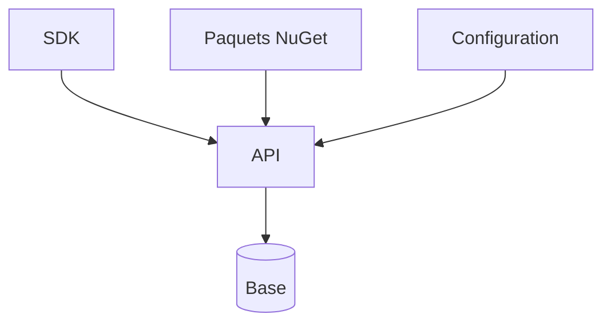
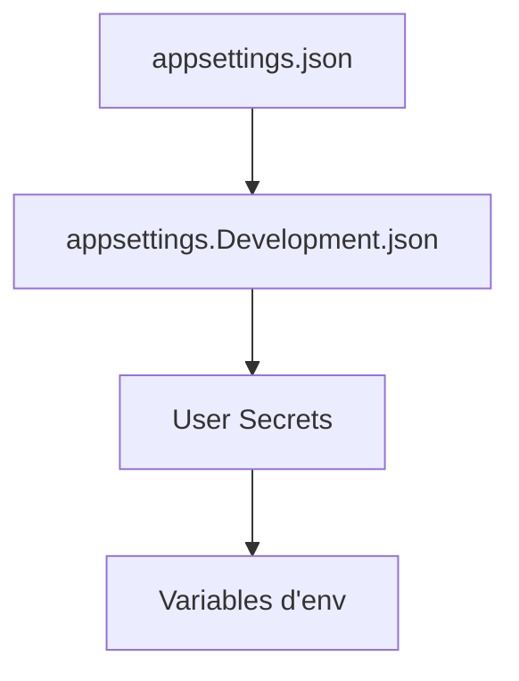
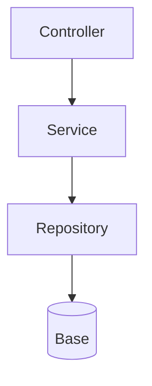

# Cours - Prendre en main un backend .NET existant

> [!abstract] Objectifs
> - Arriver sur **n'importe quel** backend .NET et le faire tourner en local
> - Savoir où regarder : version, paquets, configuration, ports, base
> - Comprendre comment le code est rangé en couches et ajouter une fonctionnalité au bon endroit

**Prérequis :** [[Cours - Une API web avec ASP.NET Core]] · [[Docker]]

## 1. Ce qu'il faut pour qu'une API .NET tourne



| Besoin | Où le trouver dans le dépôt |
|---|---|
| la bonne version du SDK | `global.json` (sinon `<TargetFramework>` dans le `.csproj`) |
| les paquets | `.csproj` (`<PackageReference>`), sources dans `NuGet.Config` |
| la configuration | `appsettings*.json`, `Properties/launchSettings.json` |
| la base de données | un `compose*.yaml` dans le dépôt, ou le README |

> [!tip] Lire avant de lancer
> README, `global.json`, `.csproj`, fichiers compose, et le **Dockerfile / la CI** : la CI fait déjà tout ce qu'il faut pour compiler. Copier ce qu'elle fait est souvent le plus court.

## 2. La version du SDK : `global.json`

```json
{ "sdk": { "version": "8.0.400", "rollForward": "latestFeature" } }
```

- `dotnet --list-sdks` : ce qui est installé. Plusieurs versions **cohabitent**, `dotnet` choisit selon le `global.json` du dossier.
- Erreur `A compatible .NET SDK was not found` → installer la version demandée, pas modifier le fichier du dépôt.
- `rollForward` : accepte une version un peu plus récente (`latestFeature` = même majeure).

## 3. Les paquets : NuGet et ses sources

`dotnet restore` télécharge les paquets depuis **toutes les sources actives**.

| Je veux… | Commande |
|---|---|
| voir les sources | `dotnet nuget list source` |
| ajouter une source (miroir, feed privé) | `dotnet nuget add source <url> -n <nom>` |
| désactiver une source bloquée | `dotnet nuget disable source nuget.org` |
| vider le cache | `dotnet nuget locals all --clear` |

| Erreur | Ça veut dire |
|---|---|
| `NU1301 Unable to load the service index` | la source est injoignable (réseau, proxy) |
| `NU1101 Unable to find package X` | aucune source active n'a ce paquet (souvent un paquet **privé**) |
| `401` sur une source | identifiant ou jeton expiré |

Config perso : `~/.nuget/NuGet/NuGet.Config`. Un `NuGet.Config` **dans le dépôt** s'applique à tout le monde.

## 4. La configuration : qui gagne ?



La **dernière lue gagne** : une variable d'environnement écrase tout.

| Source | Dans le dépôt ? | Pour quoi |
|---|---|---|
| `appsettings.json` | oui | valeurs par défaut |
| `appsettings.Development.json` | oui | surcharge en dev (`ASPNETCORE_ENVIRONMENT=Development`) |
| **User Secrets** | **non** | mots de passe en local |
| variables d'environnement | non | serveur, Docker, CI |

- Une clé `Section:Cle` en JSON s'écrit `Section__Cle` en variable d'environnement.
- User Secrets : `dotnet user-secrets set "Cle" "valeur"` dans le dossier du projet API (`list`, `remove`, `clear`). Voir [[Secret et fichier .env]].

## 5. Lancer, et trouver où ça répond

| Je veux… | Commande |
|---|---|
| tout télécharger | `dotnet restore` |
| compiler | `dotnet build` |
| lancer l'API | `dotnet run --project <Projet.Api>` |
| relancer à chaque modif | `dotnet watch run --project <Projet.Api>` |

- Les **ports** sont dans `Properties/launchSettings.json` (profils `http`, `https`) et affichés au démarrage (`Now listening on…`).
- **Swagger** (souvent `/swagger`) : tester les routes sans le front. Voir [[OpenAPI]].
- Une route protégée répond **401** : il faut un jeton (bouton « Authorize » de Swagger). Voir [[JWT]].

## 6. La base et les migrations EF Core

Une **migration** = un fichier C# qui décrit un changement de schéma. La table `__EFMigrationsHistory` retient celles déjà appliquées. Voir [[Migration de base de données]].

| Je veux… | Commande |
|---|---|
| installer l'outil (une fois) | `dotnet tool install --global dotnet-ef` |
| créer une migration | `dotnet ef migrations add <Nom> --project <Infra> --startup-project <Api>` |
| l'appliquer | `dotnet ef database update --project <Infra> --startup-project <Api>` |

- `--project` = où sont les migrations (`find . -type d -name Migrations`), `--startup-project` = le projet qui démarre (pour lire la config).
- Beaucoup d'API appliquent les migrations **au démarrage** : regarder `Program.cs` (`Migrate()`).

## 7. Comment le code est rangé : les couches



| Couche | Rôle | Ne fait pas |
|---|---|---|
| **Controller** | reçoit la requête HTTP, valide, renvoie le code de statut | pas de règle métier, pas de SQL |
| **Service** | la logique métier (règles, calculs, décisions) | ne connaît ni HTTP ni SQL |
| **Repository** | lire et écrire en base (via le `DbContext`) | pas de règle métier |
| **Base** | stocker | — |

Souvent, chaque couche est un **projet** de la solution : `*.Api`, `*.Application`, `*.Core` (ou `Domain`), `*.Infrastructure`. Voir [[Architecture en couches]] et [[Patron Dépôt (Repository)]].

Chaque couche reçoit la suivante **par son constructeur** (une interface), enregistrée dans `Program.cs`. Voir [[Service et injection de dépendances]].

## 8. Ajouter une fonctionnalité : suivre une existante

Ouvrir une fonctionnalité qui ressemble (un autre controller) et faire **le même chemin** :

| # | Je crée | Couche |
|---|---|---|
| 1 | l'entité (la classe qui devient une table) | Core |
| 2 | le `DbSet<…>` dans le `DbContext` + la migration | Infrastructure |
| 3 | le repository (interface + classe) | Infrastructure |
| 4 | le service (interface + classe) | Application |
| 5 | l'enregistrement des deux dans `Program.cs` | Api |
| 6 | le controller et sa route | Api |
| 7 | le test dans Swagger, puis en base | — |

## Pièges
> [!warning] Erreurs fréquentes
> - Modifier `global.json` ou `NuGet.Config` du dépôt pour que ça marche chez soi : ça casse chez les autres. Changer **sa** config.
> - Un mot de passe dans `appsettings.json` commité : passer par les User Secrets.
> - `Unable to resolve service for type 'IXxx'` : l'interface n'est pas enregistrée dans `Program.cs`.
> - Port déjà utilisé : une autre instance tourne (IDE + terminal). `lsof -i :<port>` puis `kill <PID>`.
> - Lancer une API qui applique ses migrations contre une base partagée : elle modifie le schéma de tout le monde.
> - Commiter une entité sans sa migration (ou l'inverse).

## Checklist « nouveau backend »
- [ ] README, `global.json`, `.csproj`, compose, CI lus
- [ ] bon SDK installé (`dotnet --list-sdks`)
- [ ] `dotnet restore` passe (sources NuGet OK)
- [ ] base lancée, config en User Secrets
- [ ] `dotnet run` + Swagger s'affiche
- [ ] une fonctionnalité existante suivie de bout en bout

## Concepts du cours
[[Projet et solution .NET]] · [[SDK]] · [[Gestionnaire de paquets]] · [[Variable d'environnement]] · [[Secret et fichier .env]] · [[OpenAPI]] · [[Migration de base de données]] · [[Architecture en couches]] · [[Patron Dépôt (Repository)]] · [[Service et injection de dépendances]]
