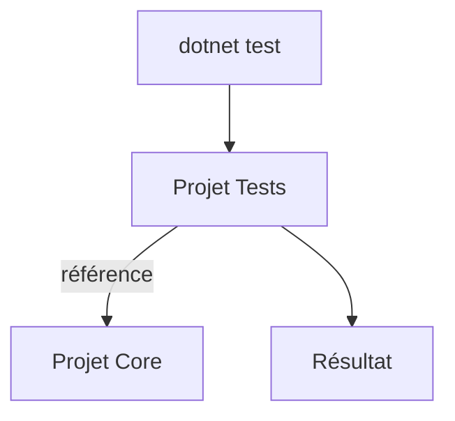

# Cours - Tester du code .NET

> [!abstract] Objectifs
> - Ajouter un projet de tests xUnit à une solution
> - Écrire des tests unitaires lisibles et les lancer avec `dotnet test`
> - Savoir tester une API ASP.NET Core sans la lancer à la main

**Prérequis :** [[Cours - Lire et écrire du code .NET]] · [[Projet et solution .NET]]

## 1. Les tests sont un projet à part
En .NET, les tests ne sont pas des fichiers à côté du code : c'est un **projet de tests** dans la solution, qui **référence** le projet testé. `dotnet test` à la racine les trouve et les lance tous. Voir [[Test automatisé]].

## 2. Schéma


## 3. Créer le projet de tests
```bash
dotnet new xunit -o tests/MesDepenses.Core.Tests
dotnet sln add tests/MesDepenses.Core.Tests
dotnet add tests/MesDepenses.Core.Tests reference src/MesDepenses.Core
dotnet test
```

## 4. Écrire un test
Une classe par chose testée, une méthode par comportement. `[Fact]` marque un test, `Assert` vérifie. Le nom dit ce qui est vérifié, et le corps suit trois temps : **préparer, agir, vérifier**.
```csharp
[Fact]
public void Corriger_refuse_un_montant_negatif()
{
    var d = new Depense("Pain", 1.2m);                         // préparer
    var action = () => d.Corriger(-5m);                       // agir
    Assert.Throws<ArgumentException>(action);                 // vérifier
}
```
`[Theory]` avec `[InlineData(…)]` lance le même test avec plusieurs jeux de valeurs. Voir [[Test unitaire]].

## 5. Remplacer une dépendance
Si la classe testée utilise une interface (`IStockage`), le test lui donne une fausse implémentation simple (en mémoire), ou une doublure créée avec une bibliothèque comme NSubstitute ou Moq. Voir [[Doublure de test (mock)]].

## 6. Tester l'API entière
Le paquet `Microsoft.AspNetCore.Mvc.Testing` démarre l'API **en mémoire** dans le test et fournit un `HttpClient` pour l'appeler : on vérifie les codes de statut et le JSON, sans port ni serveur. C'est un [[Test d'intégration]].
```csharp
public class ApiTests : IClassFixture<WebApplicationFactory<Program>>
{
    private readonly HttpClient _client;
    public ApiTests(WebApplicationFactory<Program> f) => _client = f.CreateClient();

    [Fact]
    public async Task Get_inconnu_renvoie_404()
    {
        var r = await _client.GetAsync("/depenses/999");
        Assert.Equal(HttpStatusCode.NotFound, r.StatusCode);
    }
}
```
Avec l'API minimale, ajoute `public partial class Program { }` à la fin de `Program.cs` pour que les tests voient la classe `Program`.

## Mise en pratique
- Pour chaque notion : les **exercices visuels** de sa fiche.
- Puis [[Découvrir .NET 04 - Tester avec xUnit]].

> [!warning] Erreurs fréquentes
> - Oublier la référence du projet de tests vers le projet testé : les classes « n'existent pas »
> - Un test qui dépend d'un autre (ordre, données partagées) : chaque test prépare ses propres données
> - Tester avec la vraie date ou le vrai réseau : le test passe aujourd'hui et échoue demain
> - Un test async écrit en `void` au lieu de `async Task` : xUnit ne l'attend pas

## Résumé
Pas de résumé à écrire : si tu veux, fais un dessin Excalidraw qui relie les notions ci-dessous.

## Concepts du cours
[[Test automatisé]] · [[Test unitaire]] · [[Test d'intégration]] · [[Doublure de test (mock)]]
